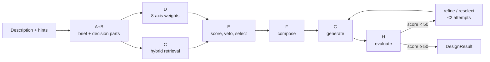

# Decision-Model Recommendation for `design-pattern-mcp`

**Scope:** choose a self-hostable typed decision model that improves pattern-selection quality and selection consistency in `design-pattern-mcp`, using the three JEV research reports in this vault plus the server's own selection pipeline, Jev integration, and Stage-0 benchmark.

**Evidence cutoff:** 2026-10-27. **Consumer:** `/home/graemer/Projekte/Python/design-pattern-mcp` (catalog 486 main records, 6,804 language files, 9 categories, 7 scopes). **Hardware:** CPUs and GPUs; training limited to 4× RTX 3090 (24 GB each, 96 GB total).

**Status:** recommendation complete, and **implemented** (2026-10-27): the four decision seams and the
rerank provider switch ship in `src/decisions/`, `src/patterns/clm_rerank.py` and the two
`docker/Dockerfile.{tacit,clm}` sidecars, all default-off — see README §"Decision models
(CLM-8B + AnyJev Tacit-4B)" and `docs/implementation-guide.md` §6/§7.1/§14. The one-line answer is
in §0; the evidence is in §1–§6; the adoption plan is in §7.

---

## 0. Executive decision

**Primary recommendation: self-host AnyJev `Decider` with the L0 readout on Qwen3-8B as the decision layer for bounded judgments, and use AnyJev `Tacit-4B` as the label-free self-distilled checkpoint when a single fixed model is preferred.** AnyJev is the only candidate with a *measured* correction for the two consistency defects that matter here — option-position bias and label prior — and it needs **zero labels**. On Qwen3-8B/BANKING77-20-way it moves answer flips on reversed options from **0.230 to 0.073**, accuracy from **0.747 to 0.803**, ECE from **0.240 to 0.184**, and the auto-decidable share at ≤5% error from **7.7% to 46.3%**, with no training [[github-nokia-applied-researchanyjev-turn-any-llm-into-a-jev-style-decision-model]] [[anyjev-technical-report]].

**But no single model covers every seam at this catalog size.** AnyJev's choice readout is documented up to **26 options** (span beyond 26 is roadmap), and the server's current style question has **36** (35 styles + `none`). The shortlist is therefore a portfolio:

| Rank | Model | Consistency-first role | Score |
|---|---|---|---|
| 1 | **AnyJev Decider + L0 (Qwen3-8B) / Tacit-4B** | category, per-candidate relevance, weights, defer/escalate; zero labels | **4.50** |
| 2 | **CLM-8B** | order-invariant ranking of arbitrary candidate sets (style 36, pattern pools, tools); heads-only training | **4.30** |
| 3 | **Eikos-4B** | calibrated choice/yes-no/score up to 100 options; best ECE in the shortlist | **4.10** |
| 4 | **Clef-flash-9B** | bit-deterministic closed-set decisions (2–26 options); strongest closed-set quality | **4.00** |
| 5 | **Kev-4B** | verified `/v1/systemone` drop-in, 255 options, choice/noul/score; trainable with `--init_from` | **3.80** |

**Two rules govern deployment.** First, **do not use any of them as the final pattern selector.** The server's selection core is deterministic arithmetic over catalog data (vetoes, MAUT, thresholds, tie-breaks, composition); a decision model belongs only in bounded judgments around it — category, relevance, complexity, weights, defer (see the decision-model evaluation skill, `skill://design-pattern-decision-model-evaluation`). Second, **no decision model fixes the dominant consistency channel** (Stage A/B decomposition). The only true repeatability fixes on this stack are an **exact-match result cache** and **serving-side batch invariance** (`VLLM_BATCH_INVARIANT=1`), the latter possible only because these models are self-hosted. Model choice enables those; it does not replace them; see `docs/SELECTION_VARIABILITY_ANALYSIS.md` (server doc, §6).

**Current Jev is not evidence for or against this recommendation.** The server uses Jev at exactly one seam — a 36-way architecture-style `choice` that overrides the LLM style only when confidence ≥ 0.5 — and the paired A/B verdict was **`candidate-loss`, keep `DECISIONS_ENABLED=false`** (p95 +9.2%, below the +15% rule; hit rate 55.6% vs 72.2%, attributable to LLM-window variance); see `docs/JEV_BENCHMARK_REPORT.md` (server doc). Style is a soft +5 affinity that only bites cross-category near-ties; it is not the lever for selection quality or consistency. The recommendation below targets the higher-leverage seams (weights, rerank relevance, category) and keeps the style seam on the LLM until a paired benchmark at those seams passes.

---

## 1. How `design-pattern-mcp` selects patterns

### 1.1 Entry points and contract

Both `select_design_patterns` (blocking) and `submit_design_job` (background, `job_id` in <100 ms) run the same `DesignPipeline.run_design` under a whole-run deadline (`tasks.deadline_seconds`, 1800 s). The phase tools (`analyze_design`, `generate_design`, `evaluate_design`) expose the same stages split. The normative specification is `docs/implementation-guide.md`; the wire contract is `docs/result-schema.json`; the catalog record contract is `docs/pattern-schema.json` (server docs).

Input: free-text `description` (1–100,000 printable characters) plus optional hints (`architecture_style` from the architecture server's 35-value enum, `language`, `paradigm`, quality attributes). Validation, enum resolution, and caller-hint precedence happen before any model call; the style hint now wins over the brief's extraction (`src/design_normalization.py:115`, fixed 2026-09-26).

### 1.2 The A–H pipeline



| Stage | What happens | Deterministic | Model-sampled | Code anchor |
|---|---|---|---|---|
| A+B | One structured call produces the `DesignBrief` **and** 1–8 decision parts; part statements become the retrieval queries | part-count bounds, merge rule, enum validation, anti-scope guard | brief prose, part splitting, style extraction | `src/pipeline.py:2074` (`_stage_a_b`) |
| C | Per part: dense (FAISS/TEI) + BM25 → fusion → **mandatory TEI cross-encoder rerank** → reciprocal-rank blend; vetoes (language, `avoid_when`, conflicts) | fusion, caps, vetoes, blend | fixed cross-encoder only (not a prompted LLM) | `src/patterns/retriever.py`; `src/pipeline.py:2181` |
| D | One batched call returns eight quality-axis weights per part; post-processing max-normalizes, smooths α=0.7, retries all-zero vectors, falls back to the mean | normalization, smoothing, fallback, MAUT | 8-axis weights | `src/pipeline.py:436` (`extract_part_weights_batch`) |
| E | `fit_score = 0.7·analysis_score + 0.3·fusion_score_normalized` plus scope +3, category ±5/−10, style +5, language ±2; rank by `fit_score` → `analysis_score` → `fusion` → catalog order → name; thresholds 50/40, near-tie 5, max 3 supporting | all of it | none | `src/pipeline.py:601` (`score_candidates`), `:715` (`select_for_part`) |
| F | Dominant election `priority × fit/100`; supporting union; application seeds; interactions; trace | all of it | none | `src/pipeline.py` (`compose_selection`) |
| G | Generate applications in batches of 5; schema/enum validation; materialize language bindings | validation, binding | generation prose | `src/pipeline.py:1466` |
| H | Evaluate 0–100; retain best; early stop at ≥50; one reselection with exclusions | score comparison, branch, retention | evaluation findings | `src/pipeline.py:1527`, `:1938` |

Only four kinds of prompted calls exist: A+B, weights, generate, evaluate. Everything from the fused candidate pool onward is arithmetic over catalog data. That is the contract a decision model must not break.

### 1.3 Where the entropy enters

The server's own analysis measured four model-dependent inputs; everything else is reproducible given its inputs; see `docs/SELECTION_VARIABILITY_ANALYSIS.md` (server doc, §2):

| Channel | Input | Effect | Measured drift |
|---|---|---|---|
| 1 (dominant) | A+B decomposition: part list and statements | Parts are the retrieval queries; different parts retrieve different pools | Controlled pairs E/F and G/H: pattern-set Jaccard **0.375**; part-id overlap **0** and **1/11**; four-call sample: 0/11 overlap in five of six pairs |
| 2 | `brief.architecture_style` | ±5 category affinity; only decides cross-category near-ties | 14/35, 11/35, 6/35 styles flip reconstructed near-ties; 0/35 for same-category pairs |
| 3 | 8-axis weight vector | Reorders `analysis_score` within a part | Recurring part vectors differed only in `scalability` (0.5819 vs 0.1153); swapping the vector alone flipped the primary; across 13 live vectors, 2/5 parts changed winner |
| 4 | Evaluate score and loop branch | Attempt 2, reselection, best-attempt retention | 3 of 8 observed runs crossed the 50-point bar; run D 51.5 vs run E 48.5 |

The same report's conclusion is the design constraint: **items 1 and 2 are the decisive observed channels; the only true repeatability fixes are an exact-match result cache (item 4) and serving-side batch invariance (item 8).** Temperature 0 cannot fix channel 1; semantic caches are unsafe for agentic traffic; request-keyed result caching is the only measure that makes two identical requests byte-identical.

### 1.4 How the server uses Jev today

Jev is wired as a **single style-substitution seam**, default-off:

- `DecisionsConfig` (`src/config.py:307-338`): `enabled=False`, `base_url=https://opencode.ai/inference/systemone/v1`, `model=jev-1.13-free`, `style_confidence_floor=0.5`, `timeout_seconds=5`.
- `DecisionModelClient.choose_style` (`src/decisions/client.py:109-206`): one `choice` question, `state=description`, criteria = 35 `STYLE_AFFINITY` keys + `none`, `POST {base}/systemone`. Exact-match LRU cache on the description bytes (256 entries); any HTTP/timeout/parse failure returns `None`; cancellation propagates.
- `_apply_decision_style` (`src/pipeline.py:2144-2163`): caller hint wins; `none` or confidence < floor keeps the LLM style; only a confident non-`none` answer overrides.
- Defaults conflict operationally: `config/config.json:130` defaults `false`, but `docker/docker-compose.yml:111` defaults `DECISIONS_ENABLED=true`. The benchmark report explicitly recommends false.

Measured A/B (6 holdout scenarios × 3 repeats, in-process Stage-0 harness); see `docs/JEV_BENCHMARK_REPORT.md` (server doc):

| Metric | Baseline (no Jev) | Jev style | Result |
|---|---|---|---|
| Holdout p95 e2e | 559,745.8 ms | 508,471.8 ms | +9.2%, below the pre-registered +15% win rule |
| Hit rate | 72.2% (13/18) | 55.6% (10/18) | −16.7 pts; quality leg passed but no gain |
| Unstable scenarios | 4/6 | 3/6 | wash under a shared style cache; repeats 2–3 reused repeat 1's Jev style |
| Verdict | — | — | **candidate-loss; keep `DECISIONS_ENABLED=false`** |

The follow-up attribution found the lone `sv` flip was LLM variance, not Jev; but the A/B still shows no demonstrated gain. The lesson is not "Jev is bad"; it is that **a 36-way style choice is the wrong place to spend a decision model**, because style is a +5 soft prior and channel 2 only decides near-ties.

### 1.5 Seams a decision model can and cannot take

The prior server analysis mapped seven seams in `docs/JEV_DECISION_MODEL_ANALYSIS_PLAN.md` (server doc, §4). Updated with the research and the current catalog:

| Seam | Shape | Decision | Rationale |
|---|---|---|---|
| **J4 weights** | 8 `score` questions per part, one state | **GO (first)** | Removes channel 3 entirely; 8 questions in one call; hardware-invariant; no prose contract |
| **J1 rerank** | `noul` per candidate (≤40 docs) | **GO (second)** | Per-doc independent relevance; order-invariant; replaces/augments TEI rerank; recall@K gate |
| **J2 category** | 9-way `choice` | **GO (third, soft)** | 9 ≪ 255; wrong category is catastrophic (−10), so confidence floor + full-corpus fallback; never a hard router |
| **J5 reasoning gate** | `noul` per phase | **GO (latency only)** | Traces are prompt context; empty trace is already a valid degradation shape; not selection-affecting |
| **Style** | 36-way `choice` | **HOLD** | AnyJev/Clef-flash cap at 26; style is +5 and near-tie-only; current A/B negative; leave on LLM or use CLM/Eikos/Kev if a benchmark demands it |
| **Final selection** | choice over 486 patterns | **IMPOSSIBLE / REJECT** | 486 > 255; would replace deterministic veto/MAUT/tie-break contracts; violates §15 determinism |
| **A+B / G / H** | prose generation | **REJECT** | The contracts require prose; decision models are prose-free; do not replace decomposition, generation, or evaluation |

**J1 context math.** The fused pool is ≤40 pattern documents; the prior analysis priced a full pool at ~40k input tokens. Only CLM `rank()` (state encoded once, each candidate embedded separately) and long-context models (Jev 64k, Span-02 131k) take the full pool in one call. Every other local model needs compact evidence or chunking: Kev-4B is validated to 8,192 tokens (the 1,024-token figure is its training state-plus-question length, not its serving validation), Nimble/Kai/jevos/Von are 8k, Clef-flash's default encode bound is 16,384, Eikos-4B serves at 16k, and AnyJev's limit follows its base (Qwen3-8B 32k). The compact-capsule experiment (top-20 overlap 18/20) supports compact evidence, but pair it with a recall check. Do not assign a full-pool J1 rerank to Kev-4B or any 8k model; use CLM `rank()` or chunk.

The decision-model lane is therefore narrow and testable: **weights, per-candidate relevance, category prior, and defer/escalate.** That is exactly the skill's guidance: bounded category, relevance, complexity, and defer judgments; keep generative extraction/generation and deterministic final selection unchanged (see `skill://design-pattern-decision-model-evaluation`).

### 1.6 Consistency levers independent of the model

Ranked by measured effect per unit of cost `docs/SELECTION_VARIABILITY_ANALYSIS.md` (server doc, §6):

1. **Honour the caller's `architecture_style`** — one line, already applied (`src/design_normalization.py:115`). Removes channel 2 for callers that pass the hint; does not fix channel 1.
2. **Stop over-claiming determinism** — `idempotent_hint=false` on the pipeline tools; delete "deterministic" from the tool description.
3. **Surface the sample** — part statements + full 8-axis vectors in `overview.reasoning` (already applied).
4. **Request-keyed result cache** — hash the canonical request + model/prompt/catalog version digest; exact matching only; TTL because the catalog changes. This is the only measure that makes repeats byte-identical.
5. **Reasoning layer off** — removes 8 sampled prompt-context calls; also removes the analyze cache hit.
6. **Freeze inputs as fixtures** — replay parts and weights; the deterministic core reproduces to max |Δ| = 0.006.
7. **Temperature 0** — variance reduction only; providers do not guarantee determinism.
8. **Serving-side batch invariance** — vLLM `VLLM_BATCH_INVARIANT=1`; bitwise-identical completions regardless of batch composition; requires self-hosted open weights; performance cost. This is the only true provider-side determinism path.

**Consequence for model choice:** self-hosting is not just a cost decision; it is the only way to get the batch-invariance guarantee. Hosted Jev cannot offer it. A local model + exact cache + batch invariance is the consistency architecture; the model ranking below assumes that architecture.

---

## 2. Evaluation criteria and scoring

### 2.1 Hard gates

A candidate is eligible only if all hold:

1. **Self-hostable** on a CPU or a 24 GB RTX 3090 (or 4×3090 for training/serving).
2. **Trainable or explicitly training-free** within the 4×3090 envelope; no recipe that requires >96 GB or undocumented multi-node training.
3. **Typed primitives** cover the intended seams: `choice`, `noul`, `score` (or a documented subset with a clear role).
4. **Option span** covers the target seam: ≥36 for the style question, ≥40 for rerank, ≥100 for wide candidate sets; otherwise a documented two-stage path.
5. **Licence** permits commercial use and does **not** require training on Jev outputs; the TypeSafe MCA bars distillation from the service or its output [[master-customer-agreement-typesafe-ai]]. CC BY-NC models are research-only.
6. **Deterministic selection is preserved**: no candidate may become the final selector or replace the veto/MAUT/tie-break contracts.

### 2.2 Criteria and weights

| Criterion | Weight | Definition | What earns a high score |
|---|---|---|---|
| **Selection consistency (C)** | **40%** | Same state → same decision under serving; invariance to option order and paraphrase; calibration of the probability used for a gate | Measured order/flip correction, per-candidate independent scoring, bit-deterministic serving, fitted calibration |
| **Quality (Q)** | 20% | Expected accuracy on the server's bounded judgments: category, relevance, weights, defer | Jev parity/beat on closed-set benchmarks; high-confidence error; calibration; prose-state evidence |
| **Training/data (T)** | 20% | Feasibility on 4×3090 and the label budget | Zero labels or full recipe + QLoRA/heads on one 3090; 18 seed scenarios mean label efficiency dominates |
| **Hosting (H)** | 10% | CPU/single-3090 fit, VRAM, latency | CPU-native or ≤10 GB GPU; no special hardware |
| **Integration (I)** | 10% | Wire/API fit to the existing client | Verified `/v1/systemone`, choice/noul/score, ≤1 adapter |

The weighted score is a **tie-breaker, not the selector**. The gates run first; a model that fails quality (Q<3) or training (T<3) is out however high it scores. Consistency carries the largest weight because the user's stated priority is selection consistency.

### 2.3 Rating rubric

| Score | Consistency (C) | Quality (Q) | Training (T) | Hosting (H) | Integration (I) |
|---|---|---|---|---|---|
| 5 | Measured order-invariance/flip correction + deterministic serving (+ calibration) | Beats/matches Jev on board/independent closed-set evidence | Zero labels, or full recipe fit on one 3090 | CPU + one 3090 | Verified TypeSafe SDK/`/v1/systemone`, all three primitives |
| 4 | Deterministic serving + order-permutation training or bit-determinism; one residual caveat | Near Jev on public/author harness; calibrated high-confidence decisions | QLoRA/heads on one 3090; labels needed | One 3090; CPU slow/quantized | Compatible endpoint; minor adapter |
| 3 | Deterministic local serving; documented order/paraphrase sensitivity; fitted temperature | Usable but behind Jev; bounded-task evidence | QLoRA on 2–4×3090 or incomplete recipe | 2–4×3090 or 24 GB tight | Own API; adapter required |
| 2 | Known flips/overconfidence without mitigation | Far behind Jev; niche only | Full FT >96 GB / no recipe | >4×3090 or special hardware | In-process only |
| 1 | Hosted/nondeterministic or no evidence | No decision evidence | No training path | Hosted only | No serving |

### 2.4 The 4×RTX 3090 envelope and the label reality

- **Serving:** 3090 = 24 GB, Ampere, bf16, no NVLink assumption. 4B bf16 ≈ 8 GB; 8B bf16 ≈ 16 GB; 9B bf16 ≈ 18–19 GB; 27B 4-bit ≈ 15–17 GB; 31B 4-bit ≈ 18 GB. One 3090 serves 4B–9B; 27B needs 4-bit or tensor parallel.
- **Training:** QLoRA fits 4B–9B on one 3090 (8B QLoRA ≈ 10–14 GB); 27B QLoRA needs 2–4 cards; full fine-tuning is comfortable up to ~2B on 4×3090, 4B needs ZeRO/sharding and is tight, and 9B+ is not a 4×3090 full-FT target. The Decision 2.0 family's full fine-tunes scale to Kai-0.6B/Nox-4B; Lux-9B/Vega-27B are not 4×3090 full-FT targets.
- **Labels are the binding constraint.** The Stage-0 corpus has **18 scenarios (12 train / 6 holdout), 18 families, 9 categories** (`tests/benchmark/scenarios/seed.json`). The Jev A/B used 6 holdout × 3 repeats. That is enough to measure a seam, not enough to fine-tune a 9B model. Zero-label methods (AnyJev L0, Tacit, CLM zero-shot heads, SemIf) are favored until a label budget exists; the RIVER gates put prompting first below ~1,000 monthly decisions and <200 labels [[when-fine-tuning-beats-prompting-the-decision-framework-river]].

### 2.5 Evidence grading

Board-verified or independently replicated figures outrank author-harness self-reports, which outrank vendor marketing. No self-reported figure is ranked against a board-verified one. In this document:

- **Board-verified/replicated:** Jev 1.13.0 74.40 composite, Nimble 60.48, decider-2b 61.68 (Doug Does 48-model board) [[jev-decision-model-benchmarks-doug-does]].
- **Independent replication:** JevBench methodology, Construct drop-in test, Aaddrick production run.
- **Author-harness / provisional:** Eikos, CLM, AnyJev, Kai, Span-02, SelfJev, Jeff-1.0, OpenJev battery.
- **Vendor:** Clef-flash Cloudflare harness, Kev project numbers, Laya project numbers.

---

## 3. The comparison matrix

### 3.1 Scored candidates (consistency-first rubric)

Weights: C 40%, Q 20%, T 20%, H 10%, I 10%. Gate failures in the last column exclude a candidate from the top 5 regardless of score.

| Project (selected build) | C | Q | T | H | I | Score | Gate / verdict |
|---|---:|---:|---:|---:|---:|---:|---|
| **AnyJev Decider + L0 (Qwen3-8B)** | 5 | 3 | 5 | 5 | 4 | **4.50** | **#1** |
| **CLM-8B** | 5 | 3 | 4 | 4 | 5 | **4.30** | **#2** |
| **Eikos-4B** | 4 | 4 | 4 | 5 | 4 | **4.10** | **#3** |
| **Clef-flash-9B** | 4 | 4 | 4 | 4 | 4 | **4.00** | **#4** |
| **Kev-4B** | 3 | 3 | 5 | 5 | 5 | **3.80** | **#5** |
| Von 395M | 5 | 2 | 4 | 5 | 4 | 4.10 | Q<3 — order-invariant but far behind on quality |
| OpenJevX (loop) | 4 | 3 | 5 | 5 | 3 | 4.00 | Workflow over Laya/Qwen bases, not a model family; tactic |
| AnyJev Tacit-4B | 4 | 3 | 4 | 5 | 3 | 3.80 | Same family as #1; checkpoint path |
| Nimble-9B | 3 | 4 | 5 | 4 | 3 | 3.70 | Complete recipe; option-order/calibration evidence thin |
| Laya 421M | 3 | 3 | 5 | 5 | 4 | 3.70 | CPU-first; high-cardinality weakness |
| Jeff-1.0 31B | 3 | 5 | 3 | 3 | 4 | 3.50 | Best quality proxy; heavy for 4×3090 |
| Kai-0.6B | 3 | 2 | 5 | 5 | 3 | 3.40 | Q<3 — smallest full fine-tune, weak quality |
| GLiNER2.5-Decide | 4 | 2 | 3 | 5 | 3 | 3.40 | Q<3 — classifier only, independent probe 25.4% |
| SemIf | 4 | 3 | 1 | 5 | 4 | 3.30 | T<3 — inference-only |
| SelfJev-4B | 3 | 3 | 4 | 4 | 3 | 3.30 | MCA/legal risk; unverified wire compatibility |
| Nox-4B | 3 | 3 | 4 | 4 | 3 | 3.30 | Decision 2.0 full FT; uncalibrated |
| openJev-verdict-2.0 | 4 | 3 | 1 | 5 | 3 | 3.20 | T<3 — no recipe |
| d1-3B | 3 | 3 | 4 | 4 | 2 | 3.20 | Fine-tune example; no model card evidence |
| Qwen-2.5-1B-RLCD | 3 | 2 | 4 | 5 | 3 | 3.20 | Q<3 — small rung |
| NanoJev 0.6B | 3 | 2 | 4 | 5 | 3 | 3.20 | Q<3 — game-domain demo |
| jevos 0.9B | 4 | 2 | 1 | 5 | 4 | 3.10 | Q<3, T<3 — CPU yes/no only |
| easy-jev 135M | 3 | 1 | 5 | 5 | 2 | 3.10 | Q<3 — Banking77 demo |
| JEV-9B | 3 | 3 | 3 | 4 | 3 | 3.10 | Catalog rung; no detailed evidence |
| Decider-2B | 2 | 3 | 4 | 5 | 4 | 3.10 | C<3 — calibration gaming |
| Jev-Omni 12B | 3 | 3 | 3 | 3 | 3 | 3.00 | Catalog rung; no detailed evidence |
| jevlike 0.5B | 3 | 1 | 4 | 5 | 2 | 2.90 | Q<3 — starter demo |
| OpenJev 27B | 3 | 4 | 1 | 3 | 4 | 2.90 | T<3 — no training doctrine; CC BY-NC |
| open-jev-deberta-v3-large | 4 | 1 | 1 | 5 | 3 | 2.80 | Q<3, T<3 — no benchmark |
| Span-02 | 3 | 4 | 1 | 1 | 5 | 2.80 | T<3, H<3 — Blackwell, no user fine-tune |
| JevK5 | 3 | 1 | 3 | 5 | 3 | 2.80 | Q<3 — demoted thin card |
| Jev-Style v3 | 3 | 3 | 1 | 5 | 3 | 2.80 | T<3 — packaging only |
| Rizzo Flow 1.7-4B | 3 | 2 | 1 | 5 | 4 | 2.70 | Q<3, T<3 — server docs only, unverified |
| OpenDecider small/nano | 3 | 2 | 1 | 5 | 2 | 2.50 | Q<3, T<3 — edge anchors |
| Bosun 0.6B | 3 | 1 | 1 | 5 | 3 | 2.40 | Q<3, T<3 — size anchor |
| d1-omni-600M | 3 | 2 | 1 | 3 | 2 | 2.30 | Q<3, T<3 — multimodal, licence |
| Tev1-4B | 3 | 2 | 1 | 3 | 1 | 2.20 | Q<3, T<3 — latency row only |
| Winnow-12B | 3 | 2 | 1 | 2 | 1 | 2.10 | Q<3, T<3, H<3 — board row only |

**Top 5 by gates + score:** AnyJev (4.50), CLM-8B (4.30), Eikos-4B (4.10), Clef-flash-9B (4.00), Kev-4B (3.80). AnyJev Tacit-4B (3.80) is the same family as #1, not a sixth shortlist slot. The first non-shortlist model alternates are Nimble and Laya at 3.70; OpenJevX (4.00) is a workflow over Laya/Qwen bases, not a model family; Von scores 4.10 but fails Q<3 (composite 27.5 vs Jev 63.3) and cannot be a top pick.

### 3.2 Fit matrix for the shortlist and key alternates

| Model (base) | Hosting | Train on 4×3090 | Quality proxy | Consistency mechanism | Span / API | Verdict |
|---|---|---|---|---|---|---|
| **AnyJev Decider (Qwen3-8B)** | 8B bf16 ≈16 GB one 3090; GGUF CPU | **None** (L0); optional QLoRA later | Qwen3-8B L0: 0.803 BANKING77-20; auto 46.3% at 5% error; no design-pattern data | L0 label-prior + rotation averaging; flips 0.230→0.073; ECE 0.240→0.184 | choice ≤26 (beyond = roadmap), yes/no, score; own `/v1/decide` | **#1**; two-stage for 36 styles |
| **CLM-8B** | 8B bf16 ≈16 GB one 3090; vLLM pooling | Heads-only; frozen 8B; batch 512 may need 2–4 cards | Zero-shot Jev parity on computer-use/gaming/tool-calling; verifier SOTA after fine-tune; provisional | Candidate embeddings scored independently → order-invariant; 13× at 1k candidates; probabilities relative to candidate set | choice/noul/score + `rank()` arbitrary candidates; TypeSafe `/v1/systemone` | **#2**; best wide-choice/rerank |
| **Eikos-4B** | 4B INT4 4.0 GB; bf16 9.3 GB one 3090 | LoRA r64, one 3090; labels needed | JevBench hard 73.9 bf16 / 72.1 INT4 vs Jev 73.0; 2.4% error at ≥90% vs 5.9%; DecisionBench 66.6 / finance 74.7 (behind Jev 69.3/79.9); ECE 0.020–0.033; provisional | Option-order permutation in training; quantization answer stability 92.5–100%; T=1 calibration | 100 options one pass (4B); choice/yes-no/score; `serve.py`/`/v1/systemone` | **#3**; best calibrated wide span |
| **Clef-flash-9B** | 9B bf16 ≈19 GB one 3090 (tight); 11–12 GB Ollama | QLoRA 13.1 GB one 3090; labels needed | Beats Jev closed-set (BFCL 98.8 vs 95.8; API-Bank 93.1 vs 88.2); loses OOS (66.8 vs 89.3) | Bit-deterministic same bytes (351 calls, 4 dp; 1,200 repeats max diff 0); ties follow option order; paraphrase moves recall ~28 pts | 2–26 options (model card/Ollama); choice/noul/score; `/v1/systemone` | **#4**; not 36-style |
| **Kev-4B** | 4B bf16 ≈8 GB one 3090; 0.8B CPU | `kev.train --init_from`; LoRA r16; labels needed | 0.52–0.69 automatable vs Jev 0.70; within 4 pts on new sources; MMLU 0.73 vs 0.90 | Fitted temperature; option order can flip; question isolation; `/permute` for order checks | 1–255 options; choice/noul/score; verified TypeSafe SDK | **#5**; verified fallback |
| Nimble-9B | 9B bf16 ≈18 GB one 3090 | QLoRA/recipe; 2,676 rows; L40S/H100 origin | 90.12% own holdout, 74.8% public vs 76.0 Jev; board 60.48 | No order/calibration measurement; local deterministic | 255 choices; 8k; token scoring | Alternate #6 |
| Laya 421M | CPU 33 ms T4; pip/ONNX | Minutes on T4/3090 | 0.766 vs Jev 0.727 typed; Banking77 0.425 vs 0.870 | Encoder deterministic; no order data; fixed head | Small label sets; Jev-compatible server/MCP | CPU alternate |
| Von 395M | CPU OpenVINO; 395M | Ladder; one GPU ~1 h | Composite 27.5 vs 63.3; calibration 75.7 | Order-invariant since 1.2 (0 flips vs 49.5%); calibrated | Any options (Option-Marker); `/v1/systemone` | CPU consistency specialist; archived |
| Kai-0.6B / Nox-4B | 0.6B CPU/GPU; 4B 8 GB | Full FT 0.6B one 3090; 4B 2–4 cards | JevArena 48.6; board 13.61; no ECE | Deterministic; uncalibrated | 255 options; 8k; `system_one()` | Smallest full-FT family |
| OpenJev 27B | 27B Q4 16.5 GB one 3090; H100 ideal | **None** (doctrine) | 84.0 vs 85.4 zero-shot on 10k | Zero-shot readout; calibration; no training | 52 options; TypeSafe-compatible | Zero-shot quality reference; CC BY-NC |
| jevos 0.9B | CPU OpenVINO 8-bit | **None** | 0.757 independent questions; English yes/no | Fixed weights; four-rung disclosure | Jev wire; yes/no/choice/score (score early) | CPU yes/no only |
| SemIf (Qwen3.5-4B) | 4B one 3090; CPU GGUF | **None** | Base-model quality; 5.21× vs JSON | One-pass logits; deterministic | Any logits; in-process | Inference-only baseline |
| Decider-2B | 2B 3.8 GB one 3090 | Recipe; 56 min B300 | Board 61.68; DI 38.17 | T=0.05 gaming; overconfident | Typed values | Calibration cautionary |
| SelfJev-4B | 4B 24 GB | 4B LoRA; labels | 95.7% text (author) | Unknown | Jev-style Noul/Choice | MCA risk — exclude |
| Jeff-1.0 31B | 31B 4-bit ~18 GB | 400 steps/5 GPU-h A100; 2–4 cards | 84.4 vs 80.1 | Recipe; no data | Jev-shaped | Quality alternate; heavy |
| Span-02 26B-A4B | Blackwell ~28 GB | **None** | 59.07 vs 60.24; ECE 0.114 vs 0.0799 | Vendor engine | 679 options | Exclude — hardware/no fine-tune |
| openJev-verdict 151M | CPU ONNX | **None** | 77.10% author; ECE 0.0144; Brier 0.0636 | Tiny deterministic ONNX | Small | CPU calibration probe |
| GLiNER2.5-Decide 340M | CPU 167 ms | Guide no numbers | 60.2 own vs 25.4 independent | Encoder deterministic | 512 tokens; labels | CPU classifier only |

### 3.3 Coverage ledger — every named project

**Scope of this evaluation.** The evaluated universe is the research program's triaged set — the ~30 named families in the three final reports (consolidated coverage) — plus the seven alternatives named in the server's own Jev analysis: Laya, Nimble, Kev, SemIf, Rizzo Flow, Von, NanoJev. It is **not** the 260-entry DecisionEval directory and **not** every open reproduction: those entries are fine-tunes, quantized builds, adapters, or packaging of the named families, or they fail the triage. The ledger below is the audit; the method is stated in §2.1.

The three research reports and the server's Jev analysis name the following distinct projects. DecisionEval's 260 entries are **113 fine-tunes, 111 quantized builds, 11 LoRA adapters, ~40 GGUF and 30 ONNX** — artifacts of these families, not 260 distinct models; thin stubs (ZefanCai Open-Jev 2B/9B/27B, 69M system-one-mini class) fail the mechanical triage (commercial-clear licence + documented base/runtime + at least one of numbers/recipe/data) [[fine-tuned-decision-models-decisioneval]] [[open-jev-9b-by-zefancai-decisioneval]] [[system-one-mini-by-davidhatley-decisioneval]].

| Project | Disposition | One-line reason |
|---|---|---|
| TypeSafe Jev 1.13/1.14 | Reference only | Hosted, no fine-tune endpoint, identical weights per account; use as judge |
| AnyJev Decider / Tacit | **Top 5 #1** | Zero-label consistency correction; 26-option cap; CPU/GPU |
| CLM-8B | **Top 5 #2** | Order-invariant candidate ranking; heads-only; TypeSafe API |
| Eikos-4B / 27B | **Top 5 #3 (4B)** | Calibrated, 100/160 options; provisional quality |
| Clef / Clef-flash | **Top 5 #4 (flash)** | Bit-deterministic 9B; 2–26 options; OOS weakness |
| Kev-0.8B/4B/9B/27B | **Top 5 #5 (4B)** | Verified System One; 255 options; order sensitivity |
| Nimble-9B | Alternate #6 | Complete recipe; close to Jev; licence split |
| Laya 421M/322M | Alternate #7 (CPU) | CPU-native; high-cardinality weakness |
| Von 395M | Alternate #8 (CPU) | Order-invariant/calibrated; quality 27.5; archived |
| Kai/Eos/Sol/Nox/Lux/Vega | Family; Kai/Nox only on 4×3090 | Full fine-tunes; uncalibrated; quality scales |
| OpenJev 27B | Alternate (zero-shot) | 84.0 vs 85.4; no training; CC BY-NC |
| OpenJevX | Tactic/loop | Cheap ONNX workflow; narrow role quality |
| Decider-2b/0.8b | Alternate (cautionary) | Board 61.68; calibration gaming |
| SelfJev-4B | Excluded | MCA contamination risk; unverified API |
| Jeff-1.0 / Inner Jev (Gemma 4 31B; Jeff-1.0-Qwen-27B) | Quality alternate | 84.4 vs 80.1; 31B heavy |
| Span-02 | Excluded | Blackwell-only self-host; no user fine-tune; ECE worse |
| jevos 0.9B | CPU yes/no alternate | 0.757; no training recipe |
| SemIf | Inference-only baseline | 5.21× faster JSON; no training |
| ollaya | Runtime tool | Jev-compatible front-end for many models; not a model |
| open-alternative-jev | Inference-only readout | No training; overconfident raw probabilities |
| openJev-verdict-2.0 | CPU probe | Author ECE 0.0144; not independently rerun |
| GLiNER2.5-Decide | CPU classifier | 512 tokens; task-mix sensitive |
| open-jev-deberta-v3-large | Excluded | No independent benchmark |
| JEV-9B, Jev-Omni | Catalog rungs | Insufficient evidence; QLoRA possible |
| Qwen-2.5-1B-RLCD | Small rung | RLCD variant; limited evidence |
| easy-jev-fine-tune | Demo/template | SmolLM2-135M Banking77; not production |
| NanoJev | Demo | Game-domain 0.6B; full recipe |
| jevlike | Demo | 0.5B starter; 26% target-disjoint |
| Jev-Style v3 | Packaging | Same weights, GGUF/MLX |
| JevK5 | Demoted | Thin card, no numbers/recipe |
| Bosun 0.6B | Size anchor | 400 MB Q4; no decision evidence |
| OpenDecider small/nano | Edge anchors | MLX 2.26 GB; author latency only |
| Winnow-12B | Board row only | 50.02 composite; no local/training evidence |
| Tev1-4B | Latency row only | 158 ms A100; no model evidence |
| Rizzo Flow 1.7-4B | Server-docs only | llama.cpp/Jev-compatible; unverified in this corpus |
| d1-3B | Fine-tune example | 30–35 min T4; no model card evidence |
| d1-omni-600M | Excluded | 587M multimodal; 15.95 DI; LFM licence |
| JevHarness | Tactic | Authoring/reflection loop, not a model |

**What "all models" means here.** Every distinct model family named in the three research reports and the server's Jev analysis appears above. Quantized/GGUF/ONNX builds and LoRA adapters are not separate models; they are deployment artifacts of the named families. The excluded demos and thin stubs are listed rather than silently dropped.

---

## 4. The five best matches, in detail

### 4.1 #1 — AnyJev Decider + L0 (Qwen3-8B) and Tacit-4B

**What it is.** AnyJev is a library that turns any open causal LM into a typed decision model by restricting the next-token distribution to option-label tokens. Two paths:

- **Decider (training-free):** L0 divides out a label prior estimated from unlabelled inputs and averages log-probabilities over cyclic option rotations. No labels, no gradients, no parameter changes [[github-nokia-applied-researchanyjev-turn-any-llm-into-a-jev-style-decision-model]] [[anyjev-technical-report]].
- **Tacit (self-distilled):** the base model writes its own problems, answers them with reasoning, and distils those answers into one forward pass. No human labels and no external model. Tacit-1.7B/2B/4B/8B/9B checkpoints exist; Tacit-4B is the 3090-friendly build [[github-nokia-applied-researchanyjev-turn-any-llm-into-a-jev-style-decision-model]].

**Hosting.** Qwen3-8B bf16 ≈16 GB, one RTX 3090; 4-bit/GGUF CPU path via llama.cpp. Tacit-4B bf16 ≈8 GB, one 3090 or CPU GGUF. Throughput is one prefill per decision; L0's rotation budget averages ~10.6 of 18 rotations at a verified 0.008 disagreement bound (2.2× serving throughput on vLLM) [[anyjev-technical-report]]. The 26-option cap is the main hosting/API limitation; the server's style question (36) needs a two-stage choice or a different model.

**Training on 4×3090.** None for Decider/L0; the whole point is zero labels. If the project later wants a domain-adapted base, QLoRA on Qwen3-8B fits one 3090; the L0 correction can still be applied at inference. Tacit-4B checkpoints are free to adopt; rerunning self-distillation is the heaviest path (teacher reasoning + distillation), but it needs no human labels.

**Expected selection quality.** Proxy: Qwen3-8B L0 on BANKING77 20-way = **0.803 accuracy**, **46.3% auto-decidable at ≤5% error**, up from 0.747/7.7% raw. The technical report's 10-model table shows the L0 gain holding across Qwen3-8B, Qwen3-4B, Phi-4-mini, Qwen3-32B, Mistral-7B, etc.; the absolute accuracy is base-dependent [[anyjev-technical-report]]. There is **no design-pattern-specific evidence**; the transfer assumption is that category (9), relevance (yes/no over provided pattern text), and weights (8 ordered scores) are easier than open-ended pattern selection. That assumption must be tested on the Stage-0 corpus.

**Expected selection consistency.** The strongest evidence in the corpus: flips on reversed options **0.230 → 0.073**, ECE **0.240 → 0.184**, auto-decidable share **7.7% → 46.3%** with zero labels (Qwen3-8B, BANKING77 20-way, 300 items) [[github-nokia-applied-researchanyjev-turn-any-llm-into-a-jev-style-decision-model]]. This directly targets the two defects that make a decision model unusable as a consistency layer: position bias and label prior. Residual risks: ECE 0.184 is improved but not low; candidate-set dependence; the 26-option cap; and the pipeline's channel 1 remains untouched.

**Fit to the server's seams.** Best at **J1 rerank** (40 independent `noul` questions, with compact evidence or chunking — the full ~40k pool is CLM-only), **J4 weights** (8 `score` questions), **J2 category** (9-way choice), and **J5 defer/escalate** (noul). For the 36-way style choice, use a two-stage choice (first category group, then ≤26 styles) or hand it to CLM/Eikos/Kev. Do not use it as the final selector.

**Verdict.** **Adopt as the primary decision layer for bounded judgments.** Start with Qwen3-8B (evidence-matched); Qwen3.5-4B is the cheaper alternative once validated. Use L0; adopt Tacit-4B when a single fixed checkpoint is preferred. Budget the two-stage style adapter and the Stage-0 benchmark.

### 4.2 #2 — CLM-8B (Contrastive Language Model)

**What it is.** A frozen Qwen3-8B encoder plus two 20M-parameter projection heads (state head, action head), trained with bidirectional InfoNCE on ~60M Q&A pairs, ~30M synthetic hard negatives, and ~1M agentic trajectories. At serving, the state and each candidate action are embedded separately; a dot product scores each candidate, and a softmax over the candidate set is the answer distribution. `rank()` handles free-form candidates (tool names, best-of-N solutions, next moves); `system_one()` handles `choice`/`noul`/`score` [[contrastive-lmclm-v01-8b-hugging-face]] [[github-contrastive-lmclm-contrastive-language-models-clms-are-a-new-class-of-sys]].

**Hosting.** Qwen3-8B embeddings + heads; vLLM pooling server on one 3090 (bf16 ≈16 GB); `clm-serve` on CPU for the API/playground (the encoder is GPU). Action embeddings are cached and reused: with ~1k candidates, CLM is **13× faster than Jev**; zero-shot it is up to **9× faster** on computer-use/gaming/tool-calling. Candidate-set scoring is one embedding per fresh text + one dot product per cached candidate [[contrastive-lmclm-v01-8b-hugging-face]].

**Training on 4×3090.** Only the two heads train; the 8B encoder stays frozen. `train/finetune.py --task clm --init-ckpt`, batch 512 (reduce/accumulate on 3090), heads-only. This is the cheapest true training in the shortlist per run. The SOTA verifier numbers (DeepSWE 81.6%, Terminal-Bench 2.1 87.6%) come from fine-tuned heads, not the zero-shot checkpoint; budget the head fine-tune [[contrastive-lmclm-v01-8b-hugging-face]].

**Expected selection quality.** Zero-shot parity with Jev on computer-use, gaming, and tool-calling (author claim; up to 9× faster); after head fine-tuning, SOTA on two agentic verifier benchmarks. There is no design-pattern evidence. The architecture is a good match for **ranking candidate patterns by how well their descriptions align with a part statement**, which is exactly J1 rerank and the wide-choice part of style/pattern selection. Treat the zero-shot quality as provisional; the head fine-tune is the real quality lever.

**Expected selection consistency.** The strongest structural guarantee in the shortlist: candidate embeddings are computed independently, so **permuting the candidate list cannot change the score of any candidate**; the softmax is over a set, not a sequence. Action embeddings are cached, so repeated candidates get identical vectors. Residual risks: probabilities are **relative to the candidate set** (not calibrated across sets); the encoder is frozen, so domain shift is handled only by the heads; and `rank()` returns a ranking, not a Jev-style confidence with the same semantics [[contrastive-lmclm-v01-8b-hugging-face]].

**Fit to the server's seams.** **J1 rerank** is the natural first use: embed the part statement once, embed each of ≤40 candidate patterns (cache across parts/runs), score by dot product, and use the score as the relevance signal. It also covers the **36-way style choice** (rank 36 style descriptions) and wide pattern candidate sets without the 26/255 option caps. It is TypeSafe-compatible (`POST /v1/systemone`, `GET /v1/models`, `GET /health`) plus `/v1/rank`; the current client needs a small adapter for `rank()` or a server-side choice wrapper.

**Verdict.** **Adopt as the wide-choice/rerank specialist.** It is #2, not #1, because its quality is less independently verified and its probabilities are candidate-set-relative. Pair it with AnyJev (bounded judgments) or Eikos (calibrated choice).

### 4.3 #3 — Eikos-4B

**What it is.** Qwen3.5-4B plus a rank-64 LoRA, distilled from GLM-5.3-Flash, with soft cross-entropy on option-letter logits, option-order permutation, a 0.3 rationale loss, and an exact `train_final.sh`. It reads `noul`/boolean, `choice`, and `score`; options are lettered A–Z then AA, AB, …; the 4B reads up to **100 options** in one pass (27B: 160; up to 588 via two-letter codes), with a tournament beyond [[caiovicentino1eikos-27b-hugging-face]] [[github-caiovicentinoeikos-open-calibrated-single-pass-typed-decision-models-4b-2]].

**Hosting.** 4B INT4 **4.0 GB**, bf16 **9.3 GB**, one RTX 3090 comfortably; FP8/MLX builds; `serve.py`/vLLM. 27B builds are 19.4 GB INT4 / 31.2 GB FP8 / 55.6 GB bf16 and want one 80–96 GB GPU (or 4-bit on a 3090, tight). For CPU, 4B is slow but usable for low volume.

**Training on 4×3090.** 4B LoRA r64 one epoch, lr 1e-4, fits one 3090 (QLoRA/LoRA); the released dataset omits 2% of rows, so retraining is close but not bit-identical. The recipe is the best-documented large-model procedure in the corpus (rank, epochs, learning rate, loss, rationale weight, both sizes' numbers) [[github-caiovicentinoeikos-open-calibrated-single-pass-typed-decision-models-4b-2]].

**Expected selection quality.** Author harness, same items. The 4B build (the 3090 target): JevBench public hard **73.9 bf16 / 72.1 INT4** vs Jev **73.0**; **2.4% error at ≥90% confidence** (both sizes) vs Jev **5.9%** and Laya **37.3%** over ~7,140 items; **DecisionBench-hard 66.6 vs Jev 69.3**; **finance 74.7 vs Jev 79.9**; ECE **0.020–0.033**. So the 4B is Jev-parity on JevBench hard and better at high confidence, but **behind Jev on DecisionBench-hard and finance**; do not read the 27B rows as 4B results. The 27B reports JevBench hard **82.0–83.8**, DecisionBench-hard **78.2–78.8**, finance **84.9–85.4**. All figures are provisional: both JevBench bench requests were still open, and public-split self-reports are not admissible as sealed scores [[caiovicentino1eikos-27b-hugging-face]] [[eikos-27b-jevbench-benchmark-heaven]]. Treat the 4B as near-parity with a calibration advantage, not as a sealed champion.

**Expected selection consistency.** ECE **0.020–0.033** across 4B builds (27B 0.041–0.043); quantization keeps ECE within 0.01 of bf16 and answers unchanged on 92.5–100% of items (100% at ≥0.9 confidence for INT4); option-order permutation is a training signal. Residual risks: T=1 default is an admitted response to fitted temperatures overfitting easy holdouts; no same-bytes flip-rate measurement; author-harness provenance [[caiovicentino1eikos-27b-hugging-face]].

**Fit to the server's seams.** The best single model for **J2 category** (9) and **J4 weights** (8 scores) and the **36-way style** (100-option capacity); also **J1 rerank** via noul, though CLM is more naturally order-invariant. It can cover all three primitive types in one `/v1/systemone` call, which simplifies the adapter. The 4B is the right build for 4×3090; the 27B is a later quality upgrade if serving hardware allows.

**Verdict.** **Adopt as the calibrated all-rounder.** It is the best answer if the project wants one model that can do 36-way style, 9-way category, 8-axis scores, and per-doc noul with a single API. Start with 4B; validate the provisional numbers on the Stage-0 corpus; do not treat the 27B author numbers as sealed.

### 4.4 #4 — Clef-flash-9B

**What it is.** Qwen3.5-9B post-trained with a joint schema head: a small transformer reads the backbone's final hidden states, routes evidence from the state to each question, and scores all options of all questions jointly. One logit per allowed option, softmaxed per question. It answers `choice`, `noul`, and `score`; API is fully Jev/SystemOne-compatible; serving via SGLang or Ollama; release ships the backbone, `joint_head.safetensors`, `load_release_model`, and a `systemone` helper [[clef-flash-hf-model-card]] [[clef-flash]].

**Hosting.** 9B bf16 ≈19 GB, one 3090 (tight but fits); 11–12 GB Ollama build; QLoRA training peak **13.1 GB** (bf16 LoRA 21.5 GB), one 3090. The 27B Clef needs an H200/two 80 GB cards and is not a 4×3090 training target. The model card's choice limit is **2–26 options**; Ollama enforces the same. That is the critical fit constraint: it can do category (9), weights (8), per-doc noul, and a 26-option subset, but **not the 36-way style** without two-stage decomposition.

**Training on 4×3090.** Community QLoRA with Unsloth (13.1 GB peak, minutes to tens of minutes); the vendor's own RLCD recipe is prose-only with no public code. The release layout makes the exact served artifact trainable: record encoding, batching, `load_release_model`, and the `systemone` helper are public [[clef-flash-hf-model-card]] [[12585patch]].

**Expected selection quality.** The strongest closed-set profile in the corpus: BFCL 98.8 vs Jev 95.8; API-Bank 93.1 vs 88.2; banking intent 90.9 vs 79.7; appliance classification 97.7 vs 52.3; median 38.8 ms vs Jev 524.1 ms on Cloudflare's harness. It loses where the correct answer is "none of the options": CLINC150+OOS 66.8 macro-F1 vs Jev 89.3 and Clef-27B 97.4; RAGTruth 35.6 vs 76.5; When2Call 65.6 vs 81.0. Construct's drop-in test: Clef 92.3%, Jev 88.6%, Flash 82.1% at matched thresholds; 93.2/90.9/90.6 at each model's own thresholds [[clef-flash-hf-model-card]] [[construct-clef-vs-jev-drop-in-benchmark]].

**Expected selection consistency.** **Bit-deterministic on identical bytes**: identical probabilities to 4 dp across all 351 calls; 1,200 repeated answers with maximum difference zero. But determinism is not stability: rewording the same yes/no question moved recall at 0.5 by nearly 28 points while PR-AUC held 0.90–0.97; changing neighbouring questions shifted answers by 0.085–0.155, with 5–16% crossing 0.5; ties follow option order (put the preferred option first). The 26-option cap is a structural consistency advantage (smaller choice sets) and a coverage limitation [[construct-clef-vs-jev-drop-in-benchmark]] [[aaddrick-clef-flash-content-filter-thresholds]].

**Fit to the server's seams.** **J2 category** (9), **J4 weights** (8), **J1 rerank** (noul), and closed-set defer decisions. It is the best pick when the seam is closed-set and ≤26 options and the priority is bit-identical repeats. It is **not** the pick for the 36-way style or for "none of these patterns fits" decisions unless paired with an abstention/outlier-exposure layer; its OOS weakness is architectural at the 9B operating point.

**Verdict.** **Adopt as the bit-deterministic closed-set specialist.** It is #4 because the 26-option cap and OOS weakness limit its coverage; its closed-set quality and same-bytes determinism are the best in the shortlist. Use it for category/weights/noul, not as the universal choice model.

### 4.5 #5 — Kev-4B

**What it is.** Qwen3.5-4B plus a rank-16 LoRA and a small pointer head; 0.8B/4B/9B on Qwen3.5 and a full-weight 27B on Qwen3.8. It serves `POST /v1/systemone`, matches the TypeSafe client contract, and its `kev.benchmark --remote` flag scores any System One endpoint. Questions are processed with the state encoded once and per-question position IDs; the pointer head scores each option's `</opt>` hidden state against the question's `<decide>` hidden state. Every checkpoint ships a fitted temperature [[github-jaredpalmerkev-jev-like-family-of-decision-models-built-on-top-of-qwen353]].

**Hosting.** 4B bf16 ≈8 GB, one 3090; 0.8B CPU/laptop; 9B ≈18 GB; 27B ≈66 GB resident (80 GB card). Kev-4B answers six questions in 18.1 ms model time on an H100 and 41.5 ms on an L40S; 721 ms for five questions on an M5 (136 ms cached). Serving allows 65,536 tokens, but validated context is 8,192 for 0.8B/4B/9B; 27B holds 65k. The MCP states are ~1–3k tokens, so this is not a binding limit [[github-jaredpalmerkev-jev-like-family-of-decision-models-built-on-top-of-qwen353]].

**Training on 4×3090.** `kev.train --init_from` a released checkpoint; LoRA + head jointly, base frozen (27B full FT). Training data shape is the API shape plus a `label`; keep 10–20% aside; 0.8B fits a 4 GB GPU at batch 1/accum 8; 4B fits one 3090 with QLoRA; ~1 h on an H100 per the project. Labels are needed, but `--init_from` preserves what Kev already knows: in one user test, fine-tuning from the base scored 0.33 vs 0.84 for the released model, while `--init_from` kept 0.83 and reached 0.88 on the new domain [[github-jaredpalmerkev-jev-like-family-of-decision-models-built-on-top-of-qwen353]].

**Expected selection quality.** On new sources, Kev-27B is within a point of Jev (0.851 vs 0.857); Kev-4B and Kev-9B are within four points; Kev-9B MMLU 0.73 vs Jev 0.90. At a 5% error budget, Kev-4B/9B/27B automate 0.52–0.69 of new-source decisions vs Jev 0.70; Kev-0.8B 0.14. Fitted temperature means probabilities are calibrated by default; Kev-9B puts ≥0.9 on a wrong answer for 2.4% of new-source questions vs Jev 3.7%. These are project-reported, not board-verified, but the methodology is unusually complete [[github-jaredpalmerkev-jev-like-family-of-decision-models-built-on-top-of-qwen353]].

**Expected selection consistency.** Fitted temperature handles calibration; question isolation means questions in one request cannot read each other (probabilities within 4e-6 together vs separate in fp32 tests). But **option order can change an answer** — question isolation does not prevent it; the project's own limitation section says so, and the server exposes `/v1/systemone/permute` for 1–64 permutations. This is why Kev scores C3, not C5. Mitigations: fixed option order in the client, permutation averaging at inference (6 permutations), exact cache, and a threshold fitted on the server's labels.

**Fit to the server's seams.** The best **verified drop-in** for the existing `/v1/systemone` client: 255 options covers the 36-style question, choice/noul/score covers all three primitives, and the TypeSafe SDK runs unchanged. Use it as the **verified fallback** if the project must not change the wire contract, or as the **quality-trained** option when labels exist. J1 full-pool rerank (~40k tokens) exceeds Kev-4B's validated 8,192-token context; a 40-way choice over compact evidence works, but CLM `rank()` is the better full-pool reranker.

**Verdict.** **Adopt as the verified System One fallback and label-trained choice model.** It is #5, not higher, because its documented option-order sensitivity and weaker calibration automation conflict with the consistency-first criterion. With fixed option order + permutation averaging + cache, it is the lowest-integration-risk path to a self-hosted Jev-compatible endpoint.

---

## 5. Near-alternates and why they missed

| Model | Why it is close | Why it is not top 5 |
|---|---|---|
| **Nimble-9B** | The only complete triple: versioned recipe (rank 16, lr 5e-5, batch 8, seed 17, 1 epoch), versioned data (2,676 rows), frozen 324-example holdout with committed Jev gap; 90.12% own / 74.8% public vs Jev 76.0; 255 choices, 8k; QLoRA on 3090 | No order/calibration measurement; licence split (Sept 24 Apache-2.0 vs v3 CC BY-NC, repo root no licence); 9B serving 18 GB; quality close but not better than Jev; consistency evidence thinner than the top 5 [[bespokelabsbespoke-nimble-9b-hugging-face]] [[bespoke-nimble-9b-matches-90-of-its-own-labels-and-748-of-a-public-suite-jev-new]] |
| **Laya 421M** | CPU-native, 33 ms on T4 vs Jev ~250 ms; 0.766 vs Jev 0.727 on typed decisions; fine-tune in minutes; pip/ONNX/MLX/Node/Docker/MCP | High-cardinality weakness: Banking77 72–77 labels 0.425 vs Jev 0.870; fixed token head gives each label few tokens; no order/calibration data; best for 9-category/8-axis/≤40 noul, not 36-style or 486 patterns [[can-you-fine-tune-jev-the-replicas-the-17-run-and-what-each-costs]] [[laya-ai-open-source-decision-model-run-locally]] |
| **Von 395M** | CPU 395M; **order-invariant since 1.2** (0 hard-tier flips over 4 orderings vs 49.5% in 1.1); calibrated temperature; TypeSafe `/v1/systemone`; 8k; Apache-2.0 | Quality composite **27.5 vs Jev 63.3** (calibration 75.7); archived 19 Oct 2026; successor d1-omni is a licence event. The best *consistency reference* on CPU, not a quality contender [[github-wfzyxvon-the-open-source-system-one-decision-model-sub-15ms-non-autoregre]] |
| **Kai-0.6B / Nox-4B** | Smallest full fine-tune; 4.9 ms; 255 options; 8k; Apache-2.0; Kai full FT on one 3090 | JevArena 48.6, board 13.61; **no calibration published** (raw head logits); quality far behind; Nox-4B is the upgrade path but still uncalibrated. Good for latency, not for gated decisions [[vllm-srdecision-20-kai-06b-hugging-face]] [[decision-20-kai-06b-to-vega-27b-modelsystemone]] |
| **OpenJev 27B** | Zero-shot **84.0 vs Jev 85.4** on 10,000 questions; 52 options; TypeSafe-compatible; no training | No training doctrine (labels live in the request); 27B Q4 16.5 GB on a 3090, H100 ideal; **CC BY-NC 4.0** weights (commercial licence via loop); the quality is zero-shot, not trainable [[openjevopenjev-hugging-face]] |
| **OpenJevX** | Cheapest reproducible loop ($1–3, 443k decisions, 3 h 4090); role accuracy 63.7→98.1, unseen families 66.1→87.3; ONNX CPU | A workflow over Laya/Qwen bases, not a model family; public typed test stayed 76.1→76.2; narrow role quality. Use as a tactic when labels are rule-derived [[fine-tune-it-on-your-decisions-openjevx]] [[before-after-openjevx]] |
| **jevos 0.9B** | CPU-native, 28/130 ms, Jev wire format, four-rung disclosure, 0.757 independent | English yes/no only; no user training recipe; arithmetic 0.58; fixed weights. CPU yes/no fallback, not a general decision model [[github-feder-crjev-jevos-an-open-source-alternative-to-jev-and-microsoft-decisio]] |
| **SemIf** | Frozen Qwen3.5-4B readout; 5.21× faster than autoregressive JSON; 18/21 agreement; no training | Inference-only baseline; quality equals the base model; no calibration or training path. A useful experiment, not a deployment [[semif-openjevreadmemd-at-master-theoleecjsemif-openjev-github]] |
| **Decider-2B** | Board 61.68; 2B/0.8B; 3.8 GB; published recipe | Calibration gaming: shut temperature 0.05 for yes/no to avoid the 0.2–0.8 wrong-band; uncalibrated probabilities; hard-tier ECE ~0.20. The dual-disclosure is exemplary, the shipped config is not [[mapikadecider-2b-hugging-face]] |
| **SelfJev-4B** | Qwen3.5-4B rank-64 LoRA; 95.7% text decisions; 24 GB GPU; Jev-style Noul/Choice | Trained on stored Jev probabilities; MCA bars distillation from the service/output; unverified wire compatibility. Exclude for commercial use [[julienheysamselfjev-4b-hugging-face]] |
| **Jeff-1.0 31B** | **84.4 vs Jev 80.1** after 400 steps / ~5 GPU-h; open recipe + OpenDecisions | 31B: 4-bit ~18 GB serving, QLoRA on 2–4 3090; 4×3060-class training is slow; no design-pattern data; heavy for a first pilot [[releasing-the-inner-jev-a-simple-recipe-for-open-decision-models]] |
| **Span-02** | 679 options; 59.07 vs 60.24; $0.01/M hosted; Apache-2.0 weights | Self-host requires a Blackwell GPU (~28 GB); no documented user fine-tune path; calibration worse than Jev (0.114 vs 0.0799). Hosted/quality reference, not 4×3090 [[span-02-by-respan-decision-model-specs-pricing-and-limits]] |

**CPU-only deployment.** If the server must run entirely on CPU, the shortlist changes: **Laya** for category/weights/noul (small label sets), **Von** for order-invariant calibrated scoring, **jevos** for English yes/no, **openJev-verdict-2.0** or **GLiNER2.5-Decide** as small classifiers. None covers the 36-style choice well; keep that on the LLM or use a two-stage LLM+small-model design. The CPU path is a quality compromise, not a like-for-like replacement.

---

## 6. Special tactics

### 6.1 AnyJev L0 as a consistency layer

L0 is not a model; it is a readout correction that can be applied to any open causal LM. Two mechanisms:

1. **Label-prior division:** estimate the model's unconditional preference for each option label from unlabelled inputs, divide it out.
2. **Rotation averaging:** read the K-option choice once per cyclic rotation of the options, map each position back to its option, and average in log space before renormalising.

The measured effect on Qwen3-8B/BANKING77-20-way: flips 0.230→0.073, accuracy 0.747→0.803, ECE 0.240→0.184, auto-decidable at 5% error 7.7%→46.3%, no labels. The rotation budget averages ~10.6 of 18 rotations at a 0.008 disagreement bound (2.2× throughput) [[anyjev-technical-report]]. **Constraint:** choice span is ≤26 options; for 36 styles, either two-stage (category group → ≤26 styles) or use CLM/Eikos/Kev. **Use it for** category (9), per-doc noul (40), weights (8 scores), defer. **Do not use it** for the full 486-pattern choice or as the final selector.

### 6.2 Tacit self-distillation

Tacit checkpoints are trained by self-distillation: the base writes its own problems, answers with reasoning, and distils to one forward pass; no human labels, no external model. Tacit-1.7B/2B/4B/8B/9B exist; Tacit-4B is the 3090 build; Tacit-9B/Tacitus-31B are heavier. Adoption is free; rerunning distillation is the heaviest path. Use it when a single fixed checkpoint is preferred over a base+readout stack, or when the project wants to freeze the behavior of a larger teacher into a 4B student. The +6.5 public-set gain over the base is the proxy; validate on the Stage-0 corpus [[github-nokia-applied-researchanyjev-turn-any-llm-into-a-jev-style-decision-model]] [[morriszjmtacit-4b-hugging-face]].

### 6.3 CLM `rank()` and candidate-embedding cache

For any seam where the candidate set is large, dynamic, or generated at runtime (styles, pattern pools, tool names, best-of-N solutions), `rank()` is a better fit than a fixed-option `choice`: embed the state once, embed each candidate, dot-product, softmax. Candidate embeddings can be cached across calls; at ~1k candidates the project claims 13× over Jev. This is the natural J1 rerank and the natural 36-style/pattern-candidate path. The cost is candidate-set-relative probabilities: calibrate per pool size, not globally [[contrastive-lmclm-v01-8b-hugging-face]].

### 6.4 Permutation averaging at inference

If the chosen model has documented option-order sensitivity (Kev, and any raw logit readout without L0), do not rely on a single ordering. Use fixed canonical ordering in the client and, where the model supports it, average probabilities over 6 cyclic permutations:

- Kev: `POST /v1/systemone/permute` with `n_perm` 1–64, default 6; average `probabilities` across permutations, then threshold.
- AnyJev: L0 already does this; use `adaptive_shifts=True`, `canonical_order=True`.
- Eikos: option-order permutation is a training signal; at inference, still fix the order for reproducibility.

Cost: 6× model time; Kev-4B at 18–41 ms per request makes this cheap; a 9B at 38–268 ms still fits the 5 s budget. Do not permutation-average a hosted model without a cache — the repeats reintroduce sampling.

### 6.5 Self-host + batch invariance + exact cache

The only true repeatability path on this stack:

1. Self-host the chosen open-weight model (AnyJev/CLM/Eikos/Clef/Kev) behind vLLM or the project server.
2. Enable `VLLM_BATCH_INVARIANT=1`; accept the throughput cost; verify bitwise-identical outputs with the same prompt at different batch sizes.
3. Add an application-level **exact-match result cache** keyed on the canonical request + model/prompt/catalog version digest, with a TTL. MCP's caching utility does not cover `tools/call`; this must be application-level.
4. Never use a semantic cache for selection; near-duplicate replay is worse than variation.

This is the architecture that makes "same request → same patterns" possible. The decision model is one component; the cache and batch invariance are the others.

### 6.6 Calibration per primitive, not per model

A model's `choice` confidence, `noul` probability, and `score` distribution are different scales; never share a threshold across them. Fit temperature/Platt on held-out **scenario families**, not on the training split, and re-fit when the catalog or prompt changes. Eikos ships T=1 because fitted temperatures overfit easy holdouts; Kev ships fitted temperatures but warns to check on your data; Clef-flash publishes no calibration method; AnyJev L0 improves ECE but leaves 0.184. The server's own benchmark computes Brier/ECE as monitoring-only per-arm diagnostics; use risk-coverage curves to choose the gate, not a single accuracy number `tests/benchmark/harness/scoring.py` (server code).

### 6.7 Two-stage choice for 36 styles and 486 patterns

When the option set exceeds the model's span:

1. **Stage 1:** a cheap decision model (AnyJev 9-way category, or CLM rank over 9 category descriptions) narrows to a category or a short list.
2. **Stage 2:** a ≤26-option choice within the shortlist (AnyJev/Clef-flash), or CLM rank over the shortlist, or the deterministic selector.

For the 36 styles specifically: use CLM rank (no cap), Eikos-4B (100 options), or Kev-4B (255 options) in one pass. Other one-pass 36-option choices are Nimble-9B (255), Kai/Decision 2.0 (255), Von (Option-Marker, any count), OpenJev (52), and Span-02 (679) — each carries its own quality, calibration, licence, or hardware caveat. Only use two-stage if the chosen model is AnyJev, Clef-flash, or an Ollama endpoint capped at 26 options. Do not ask a 2–26-option model to answer a 36-option question by silently truncating; the API will reject or the answer will be wrong.

### 6.8 Cascade, not substitution

The defensible pattern is a cascade:

- **Deterministic core** always runs: vetoes, MAUT, thresholds, tie-breaks, composition.
- **Local decision model** handles bounded judgments (weights, relevance, category, defer) and is cached.
- **Hosted Jev** remains the reference judge during evaluation (same items, `kev.compare`/Decision Index rows), not the production selector.
- **Human/LLM review band** for uncertain decisions (e.g., 0.30–0.70 probability), measured at coverage.

This preserves the server's verification program (mutation ratchet, FizzBee models over deterministic modules) and avoids turning a sampled model into the selection authority.

### 6.9 What not to do

- **Do not train on Jev outputs.** The TypeSafe MCA bars using the service or its output for distillation, imitation, or a competing product; a permissive base licence never cures output-side contamination [[master-customer-agreement-typesafe-ai]]. SelfJev is the cautionary case.
- **Do not use CC BY-NC weights commercially.** OpenJev weights are CC BY-NC 4.0; Nimble v3 is CC BY-NC; the September 24 Nimble package is Apache-2.0. Pin the artifact, not the family name.
- **Do not make a decision model the final selector.** 486 > 255, and the veto/MAUT/tie-break contracts are the verification surface.
- **Do not expect the model to fix decomposition drift.** Channel 1 is dominant; use the result cache/templates for that, not a better classifier.
- **Do not use a single threshold across models.** Clef-flash at Jev-tuned thresholds loses 8.5 points with ranking intact; optima were 0.49 (Jev), 0.22 (Clef), 0.31 (Flash) vs 0.80 in production [[construct-clef-vs-jev-drop-in-benchmark]].

---

## 7. Recommended pilot and adoption plan

### 7.1 Phase 0 — restore the baseline and build the measurement

1. Set `DECISIONS_ENABLED=false` in `docker/docker-compose.yml` (or flip the default) to match the benchmark verdict; keep `config/config.json` false. The current compose default is true.
2. Keep the caller's `architecture_style` precedence (already fixed at `src/design_normalization.py:115`); do not reintroduce channel 2 for callers who supply the hint.
3. Extend the Stage-0 corpus from 18 to **60–90 scenarios** across the 9 categories, with 2–3 sibling-family variants per scenario, family-disjoint train/holdout splits, and acceptable primary/supporting sets. The current 18 is enough for a smoke A/B, not for a cutover.
4. Log per request: part statements, full 8-axis vectors, candidate pools with `retrieval_blend`, threshold decisions, model/prompt/catalog versions. The server already discloses much of this in `overview.reasoning`; add the rest.
5. Add an exact-match **result cache** keyed on the canonical request + model/prompt/catalog digest; TTL; shared store if horizontally scaled. This is the only repeatability fix that does not change the model.

### 7.2 Phase 1 — AnyJev for weights, category, and the reasoning gate

- Stand up AnyJev `Decider` + Qwen3-8B on one 3090 behind a thin adapter that accepts the server's `choice`/`noul`/`score` shapes (or use `/v1/decide` and adapt in-process). For CPU smoke tests, use GGUF.
- Enable only **J4 weights** first: 8 `score` questions per part, map to [0,1], feed the existing `RequirementWeightsBatch` validation and all deterministic post-processing unchanged. This removes one LLM call and channel 3.
- Then **J2 category**: 9-way choice with a confidence floor; below the floor, do not narrow (full corpus). Never a hard router.
- Optionally **J5 reasoning gate**: `noul` per phase; empty non-degraded trace on "no"; latency-only.
- Measure: paired baseline vs candidate on the same scenarios; hit rate, recall@3/5, acceptable-primary F1, supporting F1, veto violations, ECE/Brier, risk-coverage, p50/p95; repeat stability (3 repeats per scenario).
- Stop rule: keep the seam only if it improves a pre-registered quality/consistency metric without a veto/fallback regression. The Jev A/B's pre-registered rule is the template.

### 7.3 Phase 2 — CLM for rerank and wide choice

- Stand up CLM-8B (Qwen3-8B embeddings + heads) on one 3090 with vLLM pooling; cache action embeddings across parts/runs.
- Replace or augment the Stage-C cross-encoder rerank with `rank()` over the ≤40 fused candidates; compare recall@K against TEI on the Stage-0 set. The prior analysis's compact-capsule experiment (top-20 overlap 18/20) suggests deep ranking is insensitive to evidence detail, but this must be measured. Every non-CLM local model must use that compact evidence or chunk: a ~40k-token pool exceeds the 8–16k validated contexts of Kev-4B, Nimble, Kai, jevos, Von, Clef-flash, and Eikos-4B.
- Use `rank()` for the 36-style choice and any candidate set >26; use `system_one` for choice/noul/score where the wire contract matters.
- Measure: recall@3/5, NDCG, end-to-end p50/p95, veto/conflict violations; candidate-order permutation invariance; per-pool calibration.

### 7.4 Phase 3 — Eikos/Clef/Kev for choice seams

- **Eikos-4B:** use for 36-style choice, category, and weights when a single calibrated model is preferred; validate the provisional JevBench/ECE numbers on the Stage-0 corpus; do not assume the 27B numbers transfer.
- **Clef-flash-9B:** use for closed-set decisions with ≤26 options where bit-identical repeats matter; add an abstention/outlier-exposure layer before trusting "none of these".
- **Kev-4B:** use as the verified `/v1/systemone` fallback; fixed option order + 6-permutation averaging + cache; fit temperature on the server's labels.
- Do not run all three in production; pick one per seam after the paired benchmark.

### 7.5 Phase 4 — fine-tune on 4×3090, only if the gates say so

Do not fine-tune before the label budget and the measured gap exist. RIVER's gates: under ~1,000 monthly decisions, prompting; 1,000–10,000 prompting unless the gap is critical; over ~10,000 evaluate fine-tuning; labels <200 prompting, 200–1,000 possible with review, >1,000 viable; no significant held-out gap means prompting wins on maintenance. Poor data yields a confidently wrong model vs a generically wrong prompted model [[when-fine-tuning-beats-prompting-the-decision-framework-river]].

If the gates pass:

| Model | Recipe on 4×3090 | Data | Expected VRAM/time |
|---|---|---|---|
| AnyJev + Qwen3-8B | QLoRA on the base; keep L0 at inference | 500–2,000 labeled decisions | ~10–14 GB, one 3090, hours |
| CLM-8B | heads-only `finetune.py --task clm --init-ckpt` | 1,000+ state/candidate pairs | frozen 8B + heads, one 3090 (batch reduce) |
| Eikos-4B | LoRA r64, 1 epoch, lr 1e-4, rationale 0.3 | JevBench-style labels; 2% rows omitted | ~10 GB, one 3090 |
| Clef-flash-9B | Unsloth QLoRA, 13.1 GB peak | 500–2,000 labeled decisions | one 3090, 30–60 min |
| Kev-4B | `kev.train --init_from`, LoRA r16 | 500–2,000 labeled decisions | ~10 GB, one 3090, hours |

Calibrate on held-out **families**, not training rows; re-fit after catalog changes; keep the deterministic selection unchanged.

### 7.6 Acceptance metrics and stop rules

- **Quality:** acceptable-primary hit rate (Wilson CI), recall@3/5, acceptable-primary F1, supporting F1, veto/conflict violations = 0.
- **Consistency:** repeat stability across 3+ repeats (same final pattern set), option-order permutation invariance, paraphrase robustness on a fixed subset, per-primitive ECE/Brier, risk-coverage at 80/90/100%.
- **Latency:** stage and end-to-end p50/p95; Jev's own cost; retrieval/rerank deltas.
- **Decision rule:** a seam ships only if the paired candidate beats baseline on the pre-registered quality/consistency metric with a CI that excludes no-effect, does not regress veto/fallback, and does not exceed the latency budget. A wash is a no.

### 7.7 Decision tree

```text
Need a decision model now?
├── No labels, need consistency → AnyJev Decider + L0 (Qwen3-8B) + exact cache
│   ├── ≤26 options → direct choice/noul/score
│   └── >26 options → CLM rank or two-stage
├── Need one model for 36-way style/100-option choice → Eikos-4B (calibrated) or Kev-4B (verified)
├── Need bit-identical closed-set repeats ≤26 options → Clef-flash-9B
├── Need wide candidate ranking/tool selection → CLM-8B rank()
├── CPU-only → Laya (category/weights), Von (order-invariant), jevos (yes/no)
└── Must keep TypeSafe SDK unchanged → Kev-4B (verified) with permutation averaging
```

---

## 8. Acceptance criteria map

| Requirement | Where satisfied |
|---|---|
| All decision models evaluated | §3.1 scored table; §3.2 fit matrix; §3.3 coverage ledger (every named family, including demos/stubs) |
| MCP selection process fully understood | §1.1–§1.6: entry points, A–H stages, deterministic contracts, four entropy channels, current Jev seam, seam table, consistency levers |
| Matrix with CPU/GPU hosting, 4×3090 training, quality, consistency | §3.1 (scores) and §3.2 (qualitative matrix); §2.4 for the 3090 envelope |
| 5 best matches, consistency first | §0 and §4; rubric in §2.2–§2.3; gates exclude high-scoring but low-quality models (Von, Kai) |
| AnyJev/Tacit tactics | §4.1 (both paths), §6.1 (L0), §6.2 (Tacit) |
| Detailed explanation of fit per model | §4.1–§4.5 (top 5); §5 (near-alternates); §3.3 (all others) |
| Clear recommendation | §0: AnyJev primary; CLM/Eikos/Clef/Kev portfolio; no final-selector replacement |

---

## Appendix A — Sources

**Research reports (vault):**
- `research/notes/final_report_jev-decision-models-eb76d8.md`
- `research/notes/final_report_jev-extension-kai-clm-anyjev-7d31a0.md`
- `research/notes/final_report_local-decision-models-finetune-b2ec29.md`
- `research/notes/final_report_jev-consolidated.md`

**Server documents/code (consumer):**
- `docs/implementation-guide.md` (normative pipeline, §1–§15)
- `docs/JEV_BENCHMARK_REPORT.md` (A/B verdict)
- `docs/JEV_DECISION_MODEL_ANALYSIS_PLAN.md` (seams J1–J7, tiers, roadmap)
- `docs/SELECTION_VARIABILITY_ANALYSIS.md` (four channels, repeatability options)
- `tests/benchmark/README.md`, `tests/benchmark/scenarios/seed.json`, `tests/benchmark/harness/scoring.py`
- `src/pipeline.py`, `src/decisions/client.py`, `src/config.py`, `config/config.json`, `docker/docker-compose.yml`
- `src/style_affinity.py`, `src/design_normalization.py`

**Model citations:** inline note links throughout; key notes are the AnyJev repo/report, CLM repo/card, Eikos card/repo, Clef-flash card/Ollama page, Kev repo, Nimble card/repo, Laya card, Von repo/card, Kai card, OpenJev card, jevos repo/wiki, SemIf README, Decider card, SelfJev card, Jeff-1.0 card/paper, Span-02 card, openJev-verdict, GLiNER, and the benchmark reports.

**Licence note:** TypeSafe MCA §2.3(b) bars distillation/imitation/competing-product use of the service or its output; Qwen base licences are Apache-2.0 but do not cure output-side contamination; CC BY-NC builds are research-only; Nimble's artifact split must be pinned. Verify licences on the exact artifacts before production.

---

## Appendix B — Model-name coverage checklist

The following names are mentioned in the three research reports and/or the server analysis; each is accounted for in §3.3, including excluded demos and thin stubs:

Kev (0.8B/4B/9B/27B), SelfJev-4B, Laya (421M/322M), Span-02, ollaya, open-alternative-jev, Inner Jev/Jeff-1.0 (Gemma 4 31B, Qwen 27B), easy-jev-fine-tune (SmolLM2-135M), Qwen-2.5-1B-RLCD, JEV-9B, Jev-Omni (Gemma-4-12B), jevos (0.9B), Decision 2.0 (Kai-0.6B, Eos-0.8B, Sol-2B, Nox-4B, Lux-9B, Vega-27B), CLM-v0.1-8B, AnyJev (Decider, Tacit-1.7B/2B/4B/8B/9B), Clef (27B), Clef-flash (9B), Nimble-9B (v1/v2/v3), Von (1.2/1.3), d1-omni-600M, Eikos-4B/27B, OpenJev (27B), OpenJevX, Decider-2b/0.8b, open-jev-deberta-v3-large, SemIf, GLiNER2.5-Decide, openJev-verdict-2.0, Jev-Style v3, NanoJev (0.6B), jevlike (0.5B), JevK5, Bosun 0.6B, OpenDecider small/nano, Winnow-12B, Tev1-4B, Rizzo Flow (1.7-4B), d1-3B, JevHarness (tactic), ZefanCai Open-Jev 2B/9B/27B (thin stubs), 69M system-one-mini class.

---

## Appendix C — 4×3090 training envelope (estimates, not benchmarks)

| Build | Method | Approx. weights/optimizer memory | 4×3090 fit | Notes |
|---|---|---|---|---|
| Qwen3-8B + AnyJev L0 | none | 16 GB inference | ✅ one 3090 | Rotation averaging multiplies forward passes, not weights |
| Qwen3-8B QLoRA | 4-bit LoRA | ~10–14 GB | ✅ one 3090 | If domain adaptation is later needed |
| Tacit-4B | inference | 8 GB | ✅ one 3090 | Rerun distillation is heavier |
| CLM-8B | heads-only | 16 GB frozen encoder + heads | ✅ one 3090 | Batch 512 may need gradient accumulation/2 cards |
| Eikos-4B | LoRA r64 | ~10–12 GB | ✅ one 3090 | 4B bf16 serving 9.3 GB, INT4 4.0 GB |
| Clef-flash-9B | QLoRA | 13.1 GB peak | ✅ one 3090 | Vendor 27B needs H200/two 80 GB |
| Kev-4B | LoRA r16 + head | ~8–12 GB | ✅ one 3090 | `--init_from`; 0.8B fits 4 GB |
| Nimble-9B | QLoRA r16 | ~13–16 GB | ✅ one 3090 | Recipe tuned on L40S/H100 |
| Kai-0.6B | full FT | ~8–12 GB | ✅ one 3090 | Full FT; no calibration |
| Nox-4B | full FT | ~48–64 GB | ⚠️ 2–4 3090 | Full FT; uncalibrated |
| Eikos-27B | QLoRA | ~24–32 GB | ⚠️ 2–4 3090 | Serving 19.4 GB INT4; not first step |
| Kev-27B | full FT | ~200 GB+ full FT (~66 GB serving) | ❌ 4×3090 | 80 GB card for serving; not a 3090 training target |
| Clef-27B | QLoRA/full | ~55 GB bf16 weights; QLoRA ≈20 GB | ❌ documented path (H200/two 80 GB) | No multi-GPU sharding documented |
| Jeff-1.0 31B | QLoRA | ~18–24 GB | ⚠️ 2–4 3090 | 4-bit serving ~18 GB; heavy |

These are planning estimates from parameter counts and the cited recipes, not measured on the target hardware. Measure with `nvidia-smi` and a small run before committing.

---

## Appendix D — Glossary

- **Choice:** pick one of K labelled options; returns a distribution and confidence.
- **Noul:** calibrated probability that a proposition is true; 0.5 means ignorance, not "middle".
- **Score:** position on an ordered scale; threshold on it, do not do arithmetic between levels.
- **L0:** AnyJev's training-free readout correction (label-prior division + rotation averaging).
- **Tacit:** AnyJev's self-distilled checkpoint family.
- **MAUT:** multi-attribute utility scoring over the 8 quality axes; deterministic.
- **Channel 1–4:** decomposition, style, weights, evaluate/loop — the four sampled inputs to selection.
- **Batch invariance:** `VLLM_BATCH_INVARIANT=1`; bitwise-identical outputs regardless of batch composition.
- **Risk-coverage:** accuracy at a given fraction of decisions accepted above a confidence threshold.
