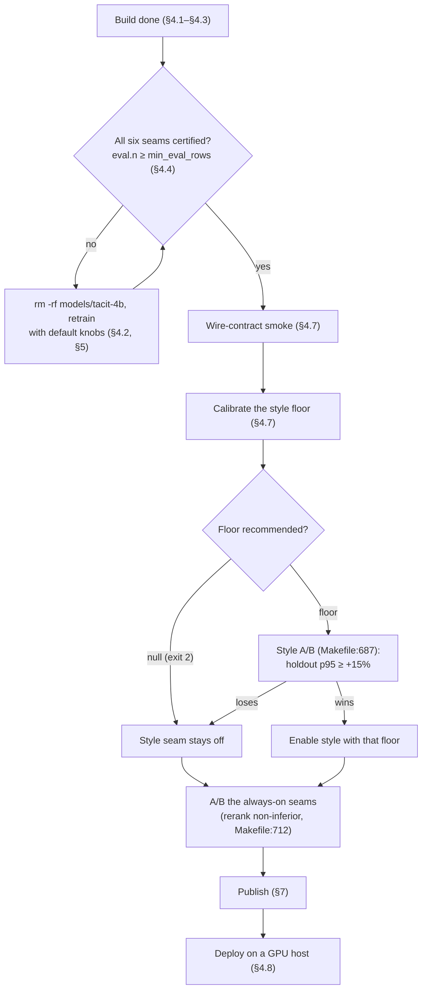

# Fine-Tuning Tacit-4B for the Decision Seams

How to self-distil the AnyJev Tacit-4B decision model, bake the result into
`design-pattern-tacit`, verify it, and publish it.

The entry point is one make rule — `make docker-build-tacit`. Training runs inside the
image build (BuildKit `RUN --device`), not on the host; the shipped image only serves.
`Makefile:390` drives `docker/Dockerfile.tacit`, whose `self-distill` stage runs
`scripts/decision_models/tacit_self_distill.py`.

Related documents: `docs/trainer-build-plan.md` (Proxmox LXC runbook, host prep),
`docs/trainer-build-plan-baremetal.md`, `docs/JEV_DECISION_MODEL_ANALYSIS_PLAN.md` (§7
outage invariant), `README.md` §Decision models.

## 1. What the fine-tune is

The released `morriszjm/Tacit-4B` (Apache-2.0) is the **teacher**. It writes decision
states in this server's own state shape, answers them with its own chain of thought, and a
QLoRA **student** (4-bit bitsandbytes + LoRA via `peft`) is trained to reproduce that
reasoning-conditioned label distribution in a single forward pass.

The questions come from `src/decisions/seam_prompts.py` — the same module the server asks
with at serving time, loaded by path so the trainer sees the exact production bytes
(`tacit_self_distill.py:409`). A prompt-vocabulary change therefore invalidates the cached
weights (it is one of `TACIT_TRAIN_INPUTS`).

Phases, all in one process (`tacit_self_distill.py:1575-1700`):

1. **Phase 1/3 — write states.** `problems // 10` design states plus gate states
   (`_GATE_SHARE = 10`), and `problems // 12` description-shaped style states
   (`_STYLE_SHARE = 12`; corpus train hints first, generated descriptions fill the rest).
   Each state prompt pairs a train hint with a rotating focus (`_STATE_FOCUSES`, one
   focus per hint cycle) so repeated hints never see a byte-identical prompt — the
   collapse mode behind the 96-of-600 build in §4.4. The phase log separates the two
   loss channels — `dropped N non-serving-shaped design states` (shape filter; fix with
   `TACIT_MAX_NEW_TOKENS=512`) and `dropped N duplicate design states` (convergence;
   fix with more hints or a higher `TACIT_STATES`) — so any shortfall in `states` is
   attributable from the log alone.
2. **Teach.** One sequential CoT `generate` per problem, sharded across the visible GPUs
   (`teacher_answers`; `TACIT_TEACHER_SHARDS=0` = one shard per device). This is the
   dominant cost.
3. **Filter.** Rows whose teacher answer is unrouted, shape-invalid (an option omitted — never
   padded and rescaled) or below `--answer-mass-floor` (default: `--confidence-floor`) /
   `--score-mass-floor` (default `0.0`, graded targets are not filtered) are dropped per
   serving kind; a kind left with fewer than `TACIT_MIN_KIND_ROWS` rows aborts the build.
4. **Phase 3/3 — QLoRA.** Single epoch over the kept rows, then the LoRA is merged and the
   merged checkpoint is what ships (fidelity is measured on the merged weights, not on the
   adapter-wrapped student).
5. **Gate + manifest.** Per-seam student-vs-teacher agreement, weights expected-level MAE,
   and a below-floor false-act probe; results go to `self-distill.json` next to the weights.

### Seams trained

| Seam label | Kind | Served by |
|---|---|---|
| `category` | `choice` | J2 category filter on part states — the same question as `style-stage1`, on a different state distribution |
| `weights` | `score` | J4 quality-axis weights |
| `gate` | `yes_no` | J5 reasoning gate |
| `style-stage1` | `choice` | Ch2 style stage 1: the category question on description states |
| `style-stage2` | `choice` | Ch2 style stage 2: ≤26-style shortlist + `none` |
| `rerank` | `yes_no` | J1 rerank stage 2: one relevance question per candidate (stage 1 is the deterministic fused pool) |

Gated seams (`_GATED_SEAMS`, `tacit_self_distill.py:1240`) are `category`, `style-stage1`,
`style-stage2`, `rerank`, `gate`; `weights` is judged by MAE instead of agreement.

## 2. Prerequisites (GPU builder)

| Requirement | Check |
|---|---|
| NVIDIA GPU, compute capability ≥ 7.5 (vLLM ≥ 7.0, 4-bit QLoRA ≥ 7.5 + bfloat16) | `nvidia-smi --query-gpu=name,compute_cap --format=csv` |
| Host driver ≥ 575.x for the pinned `vllm/vllm-openai:v0.17.1` (CUDA 12.9.1) | `cat /proc/driver/nvidia/version` |
| Docker ≥ 25 with the `dockerfile:1.14-labs` frontend (`RUN --device` does not parse on 1.7–1.13) | `docker version` |
| CDI specs generated | `ls -l /etc/cdi/nvidia.yaml` |
| `uv` on PATH for non-interactive shells (the rule shells out to `uv run` for the payload check) | `uv --version` |
| Disk: ~400 GB (vLLM layer set, two checkpoints, build cache, ~29 GB final image) | `df -h` |
| Optional HF token, raw token only, for rate limits / gated repos | `cat ~/.cache/hf_token` |

Generate the CDI spec when missing:

```bash
sudo nvidia-ctk cdi generate --output=/etc/cdi/nvidia.yaml
docker info --format '{{json .CDISpecDirs}}'
```

Over SSH, wrap in a login shell — non-interactive shells lack `uv`:

```bash
ssh <trainer> 'bash -lc "cd ~/design-pattern-mcp && make -n docker-build-tacit | head"'
```

## 3. Knobs

All are `?=` variables on the make rule and are forwarded as Docker build args.

| Variable | Default | Meaning |
|---|---|---|
| `TACIT_MODEL_REPO` | `morriszjm/Tacit-4B` | Teacher/base checkpoint |
| `VLLM_IMAGE_TAG` | `v0.17.1` | vLLM base image tag |
| `TACIT_PROBLEMS` | `6000` | Teacher question budget; state, gate and style counts derive from it |
| `TACIT_STATES` | `0` | Design states; 0 = `problems // 10`. Raise past the derived default to over-provision state diversity at the same teacher budget — each state then trains on a narrower rotating axis window (all eight axes still covered across states) |
| `TACIT_STYLE_STATES` | `0` | Ch2 description states; 0 = `problems // 12` |
| `TACIT_RERANK_PROBLEMS` | `0` | J1 questions; 0 = **all** train pairs in `qa/typed/rerank_pairs.jsonl` |
| `TACIT_TEACHER_SHARDS` | `0` | 0 = one shard per visible CUDA device (capped at 8); 1 = in-process |
| `TACIT_EPOCHS` / `TACIT_LR` / `TACIT_BATCH` / `TACIT_ACCUM` | `1` / `1e-4` / `4` / `8` | QLoRA recipe |
| `TACIT_COT_MAX_TOKENS` | `2048` | Teacher CoT bound; cost scales ≈ questions × this |
| `TACIT_MAX_NEW_TOKENS` | `256` | Bound for the state/description writing passes only |
| `TACIT_MIN_SEAM_AGREEMENT` | `0.6` | Build fails when a *certified* seam (≥20 eval rows) drops below this |
| `TACIT_CONFIDENCE_FLOOR` | `0.5` | Must equal the served `DESIGN_PATTERN_DECISIONS_*_CONFIDENCE_FLOOR` |
| `TACIT_GATE_CONFIDENCE_FLOOR` | `$(TACIT_CONFIDENCE_FLOOR)` | The reasoning gate's own floor |
| `TACIT_MIN_KIND_ROWS` | `1` | Build fails when a serving kind keeps fewer rows |
| `HF_TOKEN_FILE` | `$(HOME)/.cache/hf_token` | Mounted as a BuildKit secret; never baked |

Defaults are MAX EFFORT: ~8–9k teacher questions (category/weights/gate + ~1k style + all
~1.4k rerank pairs). Expect roughly 20–30 h on one 3090 and 5–8 h on a 4-GPU host.

## 4. Procedure

The procedure at a glance — everything after the build is a gate, and any gate can send
you back: to a retrain, or to leaving a seam switched off.



**Before anything else:** the artifact currently sitting in `models/tacit-4b/` fails step 1
below — `category` holds only 9 eval rows. Retrain once at the default shape before the
rest of this sequence is worth running (§4.4 names the exact refusal).

**Step 1 — verify the artifact (two minutes, no GPU).**

```bash
sha256sum -c models/tacit-4b/.extract-complete          # must print five OK lines
python3 - <<'PY'
import json
m = json.load(open("models/tacit-4b/self-distill.json"))
for s in ("category", "style-stage1", "style-stage2", "rerank", "gate", "weights"):
    n = int((m["eval"].get(s) or {}).get("n") or 0)
    print(f"{s:13} n={n:<4} {'certified' if n >= m['min_eval_rows'] else 'UNCERTIFIED'}")
PY
```

All six `certified` → step 2. A single `UNCERTIFIED` line → back to the start:

```bash
rm -rf models/tacit-4b && make docker-build-tacit
```

The `rm -rf` is mandatory: the cache marker hashes the train inputs only, never the knob
values (`Makefile:121-123`) — without it the next run takes the cached path and silently
re-bakes the old weights. At the default shape (`TACIT_PROBLEMS=6000`, `TACIT_STATES=0`
→ 600 states) `category` gets ~60 eval rows and all six seams certify. The
field-by-field reading of the manifest is §4.4.

**Step 2 — smoke-test against the running sidecar (GPU required).**

```bash
make docker-up-decisions
make decisions-smoke
make docker-down-decisions
```

**Step 3 — calibrate the style seam (it ships OFF).**

```bash
make docker-up-decisions
make tacit-calibrate
```

A recommended floor → note it for step 4. `null` (exit 2) → the seam stays off. Never
hand-pick a floor (§4.7).

**Step 4 — measure quality (the manifest cannot answer this).** It only proves the
student resembles its teacher, not that the decisions help the product:

```bash
make benchmark-rerank-ab
make benchmark-style-ab TACIT_STYLE_FLOOR=<floor>   # only with a floor from step 3
```

Rerank must come out non-inferior (holdout p95 within +15% of TEI) — otherwise leave
`RERANKER_PROVIDER=tei`. Enable style only if its A/B wins; the previous verdict was
candidate-loss (`docs/JEV_BENCHMARK_REPORT.md`). A certified-but-harmful seam is worse
than an absent one — a losing seam stays off in the overlay.

**Step 5 — publish.** Bump `pyproject.toml` first — `DOCKER_TAG` comes from there (if the
server image is released in the same cut, `server.json` with `packages[0].identifier`,
the Dockerfile label and `uv.lock` move with it). Commit so the tree is clean, then:

```bash
make docker-publish-tacit
```

The guard reads `min_eval_rows` from the manifest and refuses every uncertified seam —
that refusal is the guard working. Never route around it with
`TACIT_ALLOW_UNCERTIFIED=1`.

**Step 6 — deploy on the serving host.** Prerequisites: an NVIDIA GPU with the container
runtime (the overlay reserves one device) and host port 18100 free (§4.8):

```bash
TACIT_IMAGE=olkowa/design-pattern-tacit DOCKER_TAG=1.0.2 make docker-up-decisions
make decisions-smoke
```

Not `TACIT_IMAGE=olkowa/design-pattern-tacit:1.0.2 make docker-up-decisions` — the target
appends `:$(DOCKER_TAG)` itself (`Makefile:448`), producing `…:1.0.2:1.0.2`, which Docker
rejects (`invalid reference format`). The alternative is the overlay directly with
`TACIT_IMAGE=olkowa/design-pattern-tacit:1.0.2 docker compose -f docker/docker-compose.yml
-f docker/docker-compose.decision-models.yml up -d` (§4.8, form b).

**The traps at a glance:**

| Trap | Rule |
|---|---|
| A smoke build ran (small `TACIT_PROBLEMS`) | `rm -rf models/tacit-4b` before anything else — the marker does not record the knobs (§4.2) |
| Tempted to ship an uncertified artifact | `TACIT_ALLOW_UNCERTIFIED=1` is not a path; it is a deliberate provenance lie |
| Raising `TACIT_EPOCHS` because fidelity is weak | No — one epoch is the doctrine; the lever is volume (`Makefile:63-65`) |
| The style floor | Only from `make tacit-calibrate`, never by hand |
| Reading `false_act` | `n: 1, rate: 1.0` is a single row — no statement either way, and no gate reads it |
| Rerank `brier` 0.449 | Harmless for serving: the pipeline discards the score and fuses ranks only (`src/patterns/retriever.py:442`, `:474-475`) |

### 4.1 Smoke first

```bash
make docker-build-tacit \
  TACIT_PROBLEMS=200 TACIT_RERANK_PROBLEMS=100 TACIT_COT_MAX_TOKENS=512
```

This exercises the entitlement, the CDI/`ldconfig` handshake, the teacher pass, QLoRA, the
gates and the extraction marker. Expect `too thin to certify [...]` warnings — a smoke build
certifies nothing (its largest seam, rerank, holds ~10 eval rows), and that is not a failure.
Only the full build certifies every seam.

### 4.2 Drop the smoke artifact — mandatory

The cache marker (`.extract-complete`) hashes **the train inputs only** — trainer script,
`src/decisions/seam_prompts.py`, `qa/qa.jsonl`, `qa/typed/rerank_pairs.jsonl`,
`docker/Dockerfile.tacit` (`Makefile:121-123`). It does **not** hash the knob values.
A smoke build therefore leaves a marker that validates, and the next run takes the
`runtime-distilled-cached` path and silently ships the 200-problem weights.

```bash
rm -rf models/tacit-4b
```

### 4.3 Full fine-tune

```bash
set -o pipefail
make docker-build-tacit 2>&1 | tee build-tacit.log
grep -E "teacher kept .* of .* problems|wrote distilled checkpoint" build-tacit.log
```

`DOCKER_BUILD_PROGRESS` already defaults to `plain` (`Makefile:135`), so the trainer's
`logger.info` lines land in the log. `set -o pipefail` is required: without it `tee`'s exit
status masks a failed multi-hour build, and the `grep` is the proof-of-training gate — a
cached rebuild never prints either line.

What the rule does, in order:

1. `tacit-payloads-check` — regenerates `qa/typed/rerank_pairs.jsonl` to a temp path and
   byte-compares. A drift means the corpus, the noul or the catalog changed since the pairs
   were derived: run `make tacit-payloads` and commit the new artifact.
2. `check-dockerfile-shell` — dash-syntax validation of the Dockerfile payloads.
3. Cache switch — `models/tacit-4b/{config.json,self-distill.json,.extract-complete}` all
   present ⇒ `--target runtime-distilled-cached` (no GPU); otherwise
   `--target runtime-distilled` (trains).
4. `docker build --allow device=nvidia.com/gpu=all --progress=plain` with the knobs as
   `--build-arg`, tagging `design-pattern-tacit:$(DOCKER_TAG)` and `:latest`.
5. On the train path only: `docker create` + `docker cp` extracts `/models/tacit` into
   `models/tacit-4b/`, then writes `.extract-complete` **last**, containing the image tag,
   a UTC timestamp and the sha256 of every train input. A partial copy never leaves a
   reusable directory.

### 4.4 Verify the artifact

```bash
ls -lh models/tacit-4b/                      # config.json, self-distill.json, *.safetensors
python3 -m json.tool models/tacit-4b/self-distill.json | head -40
head -3 models/tacit-4b/.extract-complete    # tag + timestamp, then sha256 lines
sha256sum -c models/tacit-4b/.extract-complete   # from the repo root; five OK lines
```

The four commands answer four different questions, and none of them is "is the model good":

| Command | What it establishes |
|---|---|
| `ls -lh` | the directory holds a loadable checkpoint (`config.json`, weight shards, tokenizer files) |
| `json.tool` | the manifest parses — nothing about its contents |
| `head -3` | the marker names the image tag and the UTC extraction time (`# <image>:<tag> <timestamp>`) |
| `sha256sum -c` | the directory was extracted from a build whose train inputs were these exact bytes |

`sha256sum -c` printing five `OK` lines is the provenance gate: the marker hashes the trainer
script, `src/decisions/seam_prompts.py`, `qa/qa.jsonl`, `qa/typed/rerank_pairs.jsonl` and
`docker/Dockerfile.tacit` (`Makefile:121-123`). It does **not** hash the knob values, so it
cannot distinguish a full build from a smoke build, and it does not hash the weights — the
manifest is the only record of the shape that produced them.

#### Field inventory (`models/tacit-4b/self-distill.json`)

Every field the trainer writes, with the value observed in this repository's artifact. Values
are copied verbatim from the file; the `seams` and `eval` blocks are shown per seam.

**Provenance and counts**

| Field | Example Value Pattern | Meaning | How to Interpret |
|---|---|---|---|
| `repo` | `"morriszjm/Tacit-4B"` | Teacher/base checkpoint id, recorded for provenance | Expected: equals `TACIT_MODEL_REPO` (`Makefile:54`). Anomalous: any other id — the weights were distilled from a different base, so §1 no longer describes them. |
| `init_dir` | `"/models/tacit-4b"` | Directory the teacher was loaded from, as the trainer saw it | Expected: the in-image path `/models/tacit-4b`. Anomalous: a host path (`/home/…`, `./out/…`) — an out-of-band run (§6); its provenance is yours to assert. |
| `problems` | `3863` | Realized teacher question count, **not** the `--problems` knob | Expected: `states + states*axes_per_state + gate_states + style_problems + rerank_problems` (96+768+599+1000+1400). Anomalous: sum mismatch (hand-edited or truncated manifest) or a value far below the requested budget (mass gate-state drops). |
| `examples` | `3479` | Training rows after the eval holdout | Expected: `Σkept − Σeval.n` (3862−383). Anomalous: mismatch, or `0` (nothing was trained). |

**Retention (`kept` / `dropped`, per serving kind)**

| Field | Example Value Pattern | Meaning | How to Interpret |
|---|---|---|---|
| `kept.choice` | `1095` | Choice rows kept: category plus both style stages | Expected: `states + style_problems − dropped.choice.*` (96+1000−1). Anomalous: `0`, or below `TACIT_MIN_KIND_ROWS` (the build aborts, so such a manifest cannot exist). |
| `kept.score` | `768` | Score rows kept (J4 weights) | Expected: `states*axes_per_state` while `score_mass_floor` is `0.0`. Anomalous: a shortfall with a `0.0` floor — impossible unless the floor was raised. |
| `kept.yes_no` | `1999` | Yes/no rows kept (gate plus rerank) | Expected: `gate_states + rerank_problems` (599+1400); `retention_floor` returns `0.0` for `yes_no`, so these rows are never cut for sharpness. Anomalous: any shortfall, which then means unrouted or shape failures. |
| `dropped.choice.unrouted` | `0` | Choice rows the teacher answered without a CoT route, or with zero total mass | Expected: `0` or a handful. Anomalous: more than a few percent — teacher routing/mass failure; the seam trains on a biased subset. |
| `dropped.choice.shape` | `0` | Choice rows whose result omitted an option (never padded, never rescaled) | Expected: `0`. Anomalous: `> 0` — teacher readout shape regression; those rows are excluded rather than fabricated. |
| `dropped.choice.unsharp` | `1` | Choice rows below the acting floor (`max(target) < answer_mass_floor`); these also become the false-act probe | Expected: small. Anomalous: large — most teacher answers fall below the floor, so serving would hand most states to the LLM. |
| `dropped.score.unrouted` | `0` | Score rows with no CoT route or zero mass | Expected: `0`. Anomalous: `> 0`. |
| `dropped.score.shape` | `0` | Score rows missing an option | Expected: `0`. Anomalous: `> 0`. |
| `dropped.score.unsharp` | `0` | Score rows below `score_mass_floor` | Expected: `0` while the floor is `0.0`. Anomalous: `> 0` with a `0.0` floor (impossible), or `> 0` after raising the floor (graded levels were truncated). |
| `dropped.yes_no.unrouted` | `0` | Yes/no rows with no CoT route or zero mass | Expected: `0`. Anomalous: `> 0`. |
| `dropped.yes_no.shape` | `0` | Yes/no rows missing an option | Expected: `0`. Anomalous: `> 0`. |
| `dropped.yes_no.unsharp` | `0` | Yes/no rows below the retention floor | Must be `0`: `retention_floor("yes_no", …)` returns `0.0`, so `max(target) < 0` never holds. Any non-zero value is a trainer change or a hand edit. |

**Recipe and floors**

| Field | Example Value Pattern | Meaning | How to Interpret |
|---|---|---|---|
| `epochs` | `1` | QLoRA epochs over the kept rows | Expected: `1` (one epoch over self-distilled targets; repeating memorizes teacher noise). Anomalous: `> 1` without a documented reason. |
| `lr` | `0.0001` | AdamW learning rate | Expected: `TACIT_LR` (default `1e-4`). Anomalous: differs from the knob you believe you ran. |
| `batch` | `4` | Micro-batch rows per step | Expected: `TACIT_BATCH` (default `4`). |
| `accum` | `8` | Gradient-accumulation steps | Expected: `TACIT_ACCUM` (default `8`), i.e. an effective batch of `batch*accum` = 32 rows. Anomalous: an effective batch you did not intend — the echo is what actually ran, regardless of what you passed. |
| `confidence_floor` | `0.5` | Acting floor the choice seams gate on | Expected: equals the served `DESIGN_PATTERN_DECISIONS_*_CONFIDENCE_FLOOR` (§3). Anomalous: drift from the deployment environment — `floor_accuracy` then measures a threshold nobody serves. |
| `gate_confidence_floor` | `0.5` | The reasoning gate's own acting floor | Expected: `TACIT_GATE_CONFIDENCE_FLOOR`, default = `confidence_floor`. Anomalous: a value the gate is not actually served with. |
| `answer_mass_floor` | `0.5` | Retention floor for `choice` rows | Expected: = `confidence_floor` (the default). Anomalous: above `confidence_floor` — rows the seam would still act on are dropped from training. |
| `score_mass_floor` | `0.0` | Retention floor for `score` rows | Expected: `0.0` (graded targets are not filtered). Anomalous: `> 0` — graded rows removed and the weights seam trained on a truncated level range. |
| `eval_frac` | `0.1` | Held-out fraction, applied per seam | Expected: `0.1`. Anomalous: `0` (no eval rows, every gate skipped) or `≥ 0.5` (train set gutted). |
| `seed` | `13` | Seed for the split and the training shuffle | Expected: `13` unless deliberately changed. Anomalous: differs from the seed of a build you are comparing against — the split changes with it, so the eval rows are not the same rows. |

**Question-set shape**

| Field | Example Value Pattern | Meaning | How to Interpret |
|---|---|---|---|
| `states` | `96` | Design states actually written — distinct and serving-shaped | Expected: `TACIT_STATES` when set, else `--problems // 10`, minus states lost to shape filtering or deduplication. `generate_states` logs both loss channels — `dropped N non-serving-shaped design states` (shape filter; fix with `TACIT_MAX_NEW_TOKENS=512`) and `dropped N duplicate design states` (convergence; fix with more hints or a higher `TACIT_STATES`) — and each prompt is sampled once, so `wanted − non-serving − duplicates = states` attributes any shortfall exactly. `96` is far below the 600 a 6000-question budget derives, so either `TACIT_STATES=96` was set or most generations were dropped — the two log lines separate the causes. Anomalous: a realized count far below the request with no corresponding log line. |
| `gate_states` | `599` | Gate states kept after serving-shape normalization | Expected: close to the gate budget (`--problems // 10` = 600), minus non-serving-shaped drops. Anomalous: far below the budget — the gate trained on a narrow phase/part spread. |
| `axes_per_state` | `8` | Quality axes asked per design state | Expected: `8` = all `QUALITY_AXES` when the budget allows; `1–7` is the budget-constrained rotating window. Anomalous: `1` on a full budget (per-axis coverage collapses). |
| `style_states` | `500` | Description-shaped states for Ch2 (hints first, generated descriptions fill the rest) | Expected: `TACIT_STYLE_STATES` or `--problems // 12` (500), floored at the hint-corpus size. Anomalous: `0` (the builder aborts) or below the hint count. |
| `style_problems` | `1000` | Ch2 questions, stage 1 plus stage 2 | Expected: exactly `2 * style_states`. Anomalous: not `2×` — the builder changed and the seam mix differs from what §1 describes. |
| `rerank_problems` | `1400` | J1 relevance questions | Expected: all **train** pairs (`TACIT_RERANK_PROBLEMS=0`; the pair file holds 1400 train + 600 holdout rows) or the explicit budget, clamped to the train pairs. Anomalous: `0` (the builder aborts) or more than the train-pair count. |
| `teacher_shards` | `4` | Teacher answer shards actually used | Expected: visible CUDA devices capped at 8, or `TACIT_TEACHER_SHARDS`. Anomalous: `1` on a multi-GPU host (serial, slower, same training set) or more than the device count (impossible). |

**Gate thresholds**

| Field | Example Value Pattern | Meaning | How to Interpret |
|---|---|---|---|
| `min_seam_agreement` | `0.6` | Agreement bar for a *certified* answer seam | Expected: `0.6`. Anomalous: lowered to let a build pass — raise volume instead (§8). |
| `max_score_mae` | `0.2` | Expected-level MAE bar for a certified `weights` seam | Expected: `0.2`. Anomalous: raised to accommodate a worse fit. |
| `min_eval_rows` | `20` | Evidence floor for certification; `make docker-publish-tacit` reads **this** field (`Makefile:576`) | Expected: `20` (the trainer constant; `Makefile:59`'s comment still says 10 — the field is authoritative). Anomalous: absent (legacy manifest — the publish guard refuses it) or below `20` (weakened evidence). |

**`seams` block** — a restatement, not the certification record: each entry copies the
`eval` metrics with `n` stripped and adds the seam's total kept rows, which are **pre-split**
(`seams.weights.kept` 768 total vs `eval.weights.n` 76 held out).

| Field | Example Value Pattern | Meaning | How to Interpret |
|---|---|---|---|
| `seams.category.agreement`, `seams.category.brier`, `seams.category.floor_accuracy` | `0.7777777777777778`, `0.23419330951125505`, `0.7777777777777778` | Copy of `eval.category`'s metrics | A value here is **not** a pass: this seam is uncertified (`eval.category.n` = 9 < 20). Anomalous: values that disagree with `eval.category` — hand edit. |
| `seams.category.kept` | `96` | Total rows kept for the seam, train + eval | Expected: `states` for a clean run. Anomalous: `0`, or more than the questions built for the seam. |
| `seams.weights.agreement`, `seams.weights.brier`, `seams.weights.expected_level_mae` | `0.618421052631579`, `0.39205952062543536`, `0.1164207177937293` | Copy of `eval.weights`' metrics | Agreement is reported but **not gated** for this seam; only the MAE is. Anomalous: MAE here disagrees with `eval.weights`. |
| `seams.weights.kept` | `768` | Total weights rows kept | Expected: `states*axes_per_state`. Anomalous: shortfall with a `0.0` score floor. |
| `seams.gate.agreement`, `seams.gate.brier`, `seams.gate.floor_accuracy` | `0.8135593220338984`, `0.2029293395733144`, `0.8135593220338984` | Copy of `eval.gate`'s metrics | `floor_accuracy` is act-decision agreement at `gate_confidence_floor`. Anomalous: `floor_accuracy` > `agreement` (impossible). |
| `seams.gate.kept` | `599` | Total gate rows kept | Expected: `gate_states`. Anomalous: mismatch with `gate_states`. |
| `seams.style-stage1.agreement`, `seams.style-stage1.brier`, `seams.style-stage1.floor_accuracy` | `0.8163265306122449`, `0.27022813044057387`, `0.7346938775510204` | Copy of `eval.style-stage1`'s metrics | `floor_accuracy` ≤ `agreement` by construction. Anomalous: the inequality reversed. |
| `seams.style-stage1.kept` | `499` | Total stage-1 rows kept (one below `style_states` because the dropped choice row was a stage-1 row) | Expected: `style_states` minus any stage-1 row dropped by retention (here 500−1). Anomalous: more than `style_states`. |
| `seams.style-stage2.agreement`, `seams.style-stage2.brier`, `seams.style-stage2.floor_accuracy` | `0.76`, `0.3113958998357724`, `0.66` | Copy of `eval.style-stage2`'s metrics | Same rule as stage 1. Anomalous: same. |
| `seams.style-stage2.kept` | `500` | Total stage-2 rows kept | Expected: `style_states` on a clean run. Anomalous: more than `style_states`. |
| `seams.rerank.agreement`, `seams.rerank.brier` | `0.7071428571428572`, `0.44858291846689347` | Copy of `eval.rerank`'s metrics; no `floor_accuracy` because the seam has no thresholded act — the pipeline ranks candidates by `p(Yes)` and discards the score (`src/patterns/retriever.py:442`), fusing ranks by RRF (`:474-475`) | Agreement is the only gate. The `brier` cannot reach a served result: only the induced ordering survives, so a monotone miscalibration is unobservable downstream — ordering quality (the J1 A/B) is the real check. Anomalous: a `floor_accuracy` key here — the trainer changed. |
| `seams.rerank.kept` | `1400` | Total rerank rows kept | Expected: `rerank_problems`. Anomalous: mismatch. |

**`eval` block** — held-out, seam-stratified rows. `n` is the certification input; the rest are
fidelity measurements at the served floors. `brier` is the mean sum of squared probability
differences over the seam's option set (0 = identical distributions; range 0–2), so it is
**not comparable across seams**: the option counts differ — 9 for `category` and
`style-stage1`, 5 for `weights` (`WEIGHT_LEVELS`), 2 for `gate` and `rerank`, and 3–17 for
`style-stage2` (shortlists of 2–16 styles plus `none`; 26 is the AnyJev cap, not the width).
Compare it within a seam across builds. Anomalous: a brier that rises while agreement holds
(miscalibration), or a brier of 0 with agreement below 1 (impossible).

| Field | Example Value Pattern | Meaning | How to Interpret |
|---|---|---|---|
| `eval.category.n`, `eval.category.agreement`, `eval.category.brier`, `eval.category.floor_accuracy` | `9`, `0.7777777777777778`, `0.23419330951125505`, `0.7777777777777778` | Held-out rows for J2 category and its fidelity | Certified only when `n ≥ min_eval_rows`. Here `n = 9 < 20` → **uncertified**; the agreement is 7 of 9 rows and carries no gate weight. Anomalous: `n` far from `kept × eval_frac` (here 96 × 0.1). |
| `eval.weights.n`, `eval.weights.agreement`, `eval.weights.brier`, `eval.weights.expected_level_mae` | `76`, `0.618421052631579`, `0.39205952062543536`, `0.1164207177937293` | Held-out rows for J4 weights and their fidelity | Certified (`76 ≥ 20`); gated on `expected_level_mae ≤ max_score_mae` (0.116 ≤ 0.2), not on agreement. Anomalous: MAE above `max_score_mae` on a certified seam — the build refuses it. |
| `eval.gate.n`, `eval.gate.agreement`, `eval.gate.brier`, `eval.gate.floor_accuracy` | `59`, `0.8135593220338984`, `0.2029293395733144`, `0.8135593220338984` | Held-out rows for J5 and its fidelity | Certified; `agreement ≥ 0.6` passes. Anomalous: `agreement < min_seam_agreement` on a certified seam — the build refuses it. |
| `eval.style-stage1.n`, `eval.style-stage1.agreement`, `eval.style-stage1.brier`, `eval.style-stage1.floor_accuracy` | `49`, `0.8163265306122449`, `0.27022813044057387`, `0.7346938775510204` | Held-out rows for Ch2 stage 1 | Certified; `0.816 ≥ 0.6` passes. Anomalous: `floor_accuracy > agreement` (impossible). |
| `eval.style-stage2.n`, `eval.style-stage2.agreement`, `eval.style-stage2.brier`, `eval.style-stage2.floor_accuracy` | `50`, `0.76`, `0.3113958998357724`, `0.66` | Held-out rows for Ch2 stage 2 | Certified; `0.76 ≥ 0.6` passes. Anomalous: `n` below 20 — then the seam is skipped, not failed. |
| `eval.rerank.n`, `eval.rerank.agreement`, `eval.rerank.brier` | `140`, `0.7071428571428572`, `0.44858291846689347` | Held-out rows for J1 stage 2 | Certified; `0.707 ≥ 0.6` passes. Anomalous: `agreement < 0.6` — the build refuses it. |

**`false_act`** — below-floor probe, excluded from both train and eval.

| Field | Example Value Pattern | Meaning | How to Interpret |
|---|---|---|---|
| `false_act.n` | `1` | Number of below-floor `choice` probe rows | Expected: equals `dropped.choice.unsharp`. Anomalous: mismatch — the probe was built from a different filter. |
| `false_act.rate` | `1.0` | Fraction of probe rows where the student's `max(prob)` cleared `confidence_floor` anyway | Advisory only: no gate reads it. Expected: low at a large `n` (the student abstains where the teacher did). Anomalous: high at a large `n` — the student acts where the teacher abstained. At `n = 1`, `1.0` is one observation and supports no conclusion either way. |

#### Count invariants

Three equalities tie the blocks together; a mismatch means the manifest was edited or a copy
was truncated. Equivalently, `problems = examples + Σeval.n + Σdropped`
(3863 = 3479 + 383 + 1):

```bash
python3 - <<'PY'
import json
m = json.load(open("models/tacit-4b/self-distill.json"))
problems = (m["states"] + m["states"] * m["axes_per_state"] + m["gate_states"]
            + m["style_problems"] + m["rerank_problems"])
kept = sum(m["kept"].values())
dropped = sum(v for kind in m["dropped"].values() for v in kind.values())
eval_rows = sum(int((m["eval"].get(s) or {}).get("n") or 0) for s in m["eval"])
print("problems", m["problems"] == problems)
print("kept    ", kept == m["problems"] - dropped)
print("examples", m["examples"] == kept - eval_rows)
PY
```

Expected output for a consistent manifest: `True` on all three lines. This artifact
reconciles to 3863 problems, 3862 kept rows and 3479 training examples.

#### Certification check

`min_eval_rows` decides which seams count, and the publish guard applies exactly this rule
(`Makefile:576`):

```bash
python3 - <<'PY'
import json
m = json.load(open("models/tacit-4b/self-distill.json"))
floor = m["min_eval_rows"]
for seam in ("category", "style-stage1", "style-stage2", "rerank", "gate", "weights"):
    n = int((m["eval"].get(seam) or {}).get("n") or 0)
    print(f"{seam:13} n={n:<4} {'certified' if n >= floor else 'UNCERTIFIED'}")
PY
```

This repository's artifact prints:

```
category      n=9    UNCERTIFIED
style-stage1  n=49   certified
style-stage2  n=50   certified
rerank        n=140  certified
gate          n=59   certified
weights       n=76   certified
```

So the artifact is provenance-valid and internally consistent, but **one seam is
uncertified**: a 96-state build gives `category` only `96 × 0.1 = 9` eval rows, below the
20-row floor. `make docker-publish-tacit` therefore refuses it — `ERROR: uncertified seams
['category'] - fewer than 20 eval rows each; run the full build or pass
TACIT_ALLOW_UNCERTIFIED=1`, exit 1. Local serving is unaffected; publishing is the gate (§7).
The other five seams are certified and clear their bars.

The build refuses to ship an under-trained seam, but certifies only what it has evidence for:
the eval split is **stratified by seam**, and a seam needs ≥20 eval rows before its agreement
(or the weights MAE) is enforced — an evidence floor, not a power guarantee (a true-0.5 seam
still clears the 0.6 bar 25% of the time at 20 rows). A full default-shape build (600 design
states) holds ~60/60/50/50/140/480 eval rows across
`category`/`gate`/style-stage1/style-stage2/`rerank`/`weights`, where the gate has real
power, and certifies all six; the smoke shape certifies nothing and logs every seam as
skipped. `TACIT_MIN_KIND_ROWS` is independent and always enforced.

Fidelity is not task quality: `eval` compares the student with the teacher it was distilled
from. External quality stays with the serving-side benchmark. Serving is §4.8.

### 4.5 CPU production support

**CPU-only production serving is not supported.** The sidecar runs this checkpoint in CUDA
vLLM; the repository ships no CPU serving path, no CPU image and no CPU validation for the
artifact. A GPU-free host can *build* and *inspect* the image (§4.6), not serve it.

1. **The runtime is CUDA vLLM.** `runtime-base` is `FROM vllm/vllm-openai:${VLLM_IMAGE_TAG}`
   (`docker/Dockerfile.tacit:168`, default `v0.17.1`), the entrypoint starts
   `vllm serve "${MODEL_DIR}"` (`docker/tacit-entrypoint.sh:34`), and the compose overlay
   reserves an NVIDIA device by CDI name — `nvidia.com/gpu=0`
   (`docker/docker-compose.decision-models.yml:41-42`). The overlay calls the sidecar GPU-only
   (`docker/docker-compose.decision-models.yml:7`), and the Dockerfile scopes the GPU-free
   variant to "build and inspect the image" (`docker/Dockerfile.tacit:23`).
2. **The artifact is a bitsandbytes 4-bit checkpoint.** `models/tacit-4b/config.json` declares
   `"quant_method": "bitsandbytes"`, `"load_in_4bit": true`, `"bnb_4bit_quant_type": "nf4"`,
   `"bnb_4bit_quant_storage": "uint8"` and `"bnb_4bit_use_double_quant": true`; the safetensors
   header holds 1658 tensors: 756 `U8` packed weights alongside `nested_absmax` /
   `nested_quant_map` / `quant_map` F32 sidecars. It is not an FP32/FP16/BF16 checkpoint that a
   CPU backend can load as-is.
3. **vLLM's CPU backend does not support that quantization.** The official CPU page documents
   basic serving with FP32, FP16 and BF16, and the quantization support matrix marks
   bitsandbytes unsupported on both x86 CPU and Arm CPU:
   <https://docs.vllm.ai/en/latest/getting_started/installation/cpu/> and
   <https://docs.vllm.ai/en/latest/features/quantization/>. The CUDA bitsandbytes path is an
   out-of-tree plugin, `vllm-bnb-plugin`:
   <https://docs.vllm.ai/en/latest/features/quantization/bnb/>.

The gateway is not the blocker: `anyjev.serve` is a thin HTTP client in front of an
OpenAI-compatible upstream (`--upstream http://127.0.0.1:${UPSTREAM_PORT}/v1` in
`docker/tacit-entrypoint.sh`; the `_ServerEngine` docstring in
`models/tacit-4b/tacit_decision.py` says only the tokenizer loads on the client). The blocker
is the engine plus the quantized checkpoint. The checkpoint's own module also documents a
`transformers` engine, but this repository never wires it and no CPU run of it is validated
here.

#### Supported alternative: GPU sidecar

Prerequisites on the serving host: an NVIDIA GPU and a Docker host with the NVIDIA container
runtime (the overlay reserves the device); the `nvidia-smi` check in §2 applies. Then:

```bash
make docker-up-decisions          # sidecar + stack, one GPU (compose overlay)
make decisions-smoke              # POST /v1/decide + GET /v1/stats on 127.0.0.1:18100
curl -s http://127.0.0.1:18100/v1/stats   # gateway health, no model call
make docker-down-decisions
```

A published artifact is consumed with the same target:

```bash
TACIT_IMAGE=olkowa/design-pattern-tacit:1.0.1 make docker-up-decisions
```

The image must be one that carries the fine-tuned weights; `:base` is the released (untrained)
checkpoint (§5).

#### Supported alternative: no decision models

Without a GPU, run the base stack and leave the overlay off. The base compose file has no
decision-model environment and `config/config.json` defaults every seam to false; an
unreachable sidecar degrades to the non-model path (LLM style and weights, TEI rerank,
unfiltered retrieval, reasoning runs) and never fails a tool call
(`docker/docker-compose.decision-models.yml:13-14`).

If CPU serving becomes a hard requirement, it needs an out-of-tree re-export of the checkpoint
to a format the chosen CPU engine supports, plus a fresh validation of all six seams. This
repository produces and validates neither, so that route is unsupported and unmeasured here.

### 4.6 Rebuild without a GPU (optional)

The extracted checkpoint is the portable artifact, but its marker is validated against
**that host's** `TACIT_TRAIN_INPUTS` — the trainer script, `src/decisions/seam_prompts.py`,
`qa/qa.jsonl`, `qa/typed/rerank_pairs.jsonl` and `docker/Dockerfile.tacit` must be
byte-identical there. Start from an empty directory so stale shards cannot survive the copy:

```bash
ssh <build-host> 'rm -rf ~/design-pattern-mcp/models/tacit-4b'
rsync -a models/tacit-4b/ <build-host>:~/design-pattern-mcp/models/tacit-4b/
ssh <build-host> 'bash -lc "cd ~/design-pattern-mcp && make docker-build-tacit"'
```

When the inputs differ the rule refuses with `is stale` (it does not silently retrain). Then
either restore the exact bytes, or build the cached stage directly and own the provenance
claim — `docker build --target runtime-distilled-cached -f docker/Dockerfile.tacit .` — which
needs no GPU and skips the marker check. `.dockerignore` keeps `models/tacit-4b/` in the
build context; the `runtime-distilled-cached` stage `COPY`s it and fails fast when
`config.json` or `self-distill.json` is empty. The weight shards are deliberately untracked
in git — never commit them.

### 4.7 Smoke the wire contract, then calibrate

```bash
make docker-up-decisions      # sidecar + stack, one GPU
make decisions-smoke          # POST /v1/decide + GET /v1/stats on 127.0.0.1:18100
make docker-down-decisions
```

Every seam ships uncalibrated. The Ch2 style seam stays off until the floor is measured:

```bash
make docker-up-decisions
make tacit-calibrate          # two-stage replay over qa/typed/style.jsonl
```

`models/tacit-calibration.json` either recommends a floor — set
`decisions.style.confidence_floor` to it and `DECISIONS_STYLE_ENABLED=true` — or recommends
`null` (exit 2), in which case the seam stays off. Do not hand-pick a floor to make it pass.

#### The calibrate step in detail

`make tacit-calibrate` (`Makefile:504`) replays the **holdout** rows of
`qa/typed/style.jsonl` — 30 of the file's 169; `load_rows` keeps `source.split ==
"holdout"` and refuses training rows (`tacit_calibrate.py:167-182`) — through the served
two-stage style path of a **running** gateway, reports acted rate, acted accuracy, ECE and
Brier per candidate floor, and recommends the lowest floor that clears the
accuracy/acted-rate bars (`Makefile:490-494`). The prerequisite is a live gateway:
`make docker-up-decisions` (the default `TACIT_BASE_URL` is the overlay's loopback
`http://127.0.0.1:18100`), or on a build-only LXC the host-networked sidecar
(`docs/trainer-build-plan-baremetal.md:296-305`): `docker run -d --name
design-pattern-tacit-host --network host <image>`, then `make tacit-calibrate
TACIT_BASE_URL=http://127.0.0.1:8100 TACIT_SERVED_CONTAINER=design-pattern-tacit-host`
— the container name differs from the compose default, and it is what the report's
`served.image_id` is read from.

It writes exactly one file — `models/tacit-calibration.json` (`TACIT_CAL_REPORT`,
`Makefile:497`) — and alters nothing else. The file belongs to a serving run, not to the
checkpoint: it is not one of `TACIT_TRAIN_INPUTS` (`Makefile:121-123`) and never enters
the image. It records the split, the label-review state, the recommendation and a `served`
block: gateway URL, container name, image ID, image tag, container start time and
`TACIT_MODEL_REPO`. The recipe fills all five (`Makefile:512-516`): image ID, image tag and
container start time from `docker inspect`, the container name and model repo from make
variables — never typed by hand, because `anyjev.serve` reports no identity over the wire
(`tacit_calibrate.py:129-153`). So a 30-row measurement names the checkpoint that produced it,
and a container left running across a rebuild is visible in `container_started_at`. An unset
flag is `null`: provenance is recorded, never gated, which is why the script still runs against
a remote gateway on a host with no docker. There `docker inspect` cannot see the container, so
the block is null unless the target itself runs on the serving host — which is why the LXC
lane above passes the `docker run` name explicitly (`TACIT_SERVED_CONTAINER`), its sidecar
being `design-pattern-tacit-host` rather than the compose service's `design-pattern-tacit-dev`.

| Consumer | Reads the file? | How the floor reaches it |
|---|---|---|
| The sidecar container | No | as an env var at stack start: `DECISIONS_STYLE_ENABLED=true DECISIONS_STYLE_CONFIDENCE_FLOOR=<floor> make docker-up-decisions` |
| `make benchmark-style-ab` | Yes — `TACIT_STYLE_FLOOR` is derived from it (`Makefile:501-502`); the target exits 1 with no usable floor (`Makefile:688`) | the style-on arm runs the measured threshold, never a hand-copied one (override `TACIT_STYLE_FLOOR=<v>` only to re-test deliberately) |
| `make docker-build-tacit` | No — not baked, not hashed | only a **future deliberate retrain** couples to it: if the floor differs from `0.5`, pass `TACIT_CONFIDENCE_FLOOR=<floor>` so the fidelity eval replays the threshold serving actually uses (knobs are not hashed — pair the retrain with `rm -rf models/tacit-4b`, §4.2) |

Expect a refusal until the label review lands: the calibrator recommends nothing while
`qa/typed/review.json` has not certified the style label source byte-for-byte — the
report carries that state as `label_review.certified` (`tacit_calibrate.py:545`) — and the
corpus is human-expert-review pending. Exit 2 with a `FAIL:` reason is that gate working:
the style seam stays dark, and the remedy is completing the review and recording it in
the ledger (`qa/typed/README.md:30-33`), never hand-picking a floor. The other five seams
are unaffected: they act on their own floors — category and the reasoning gate at the
default `0.5`, which already matches the trained `TACIT_CONFIDENCE_FLOOR`, and `weights`
gates on expected-level MAE, not a floor.

### 4.8 Production: serving the verified artifact (GPU only)

§4.1–§4.7 produce, verify and smoke the artifact; this section is what a serving host runs.
The sidecar image is the only supported serving path, and that path is GPU-only (§4.5).

#### Prerequisites

| Requirement | Check |
|---|---|
| NVIDIA GPU and a Docker host with the NVIDIA container runtime (the overlay reserves `count: 1`, `capabilities: [gpu]`) | `nvidia-smi`; GPU, driver and CDI checks in §2 |
| An image that carries **distilled** weights, not `:base` | `docker run --rm --entrypoint ls <image> /models/tacit` lists `self-distill.json` |
| A calibrated style floor if the Ch2 seam is enabled | `make tacit-calibrate` (§4.7) |
| Host port 18100 free (published to loopback only) | `ss -ltn \| grep -F 18100` (no output = free) |

`design-pattern-tacit:base` is the released, untrained checkpoint: its `/models/tacit` holds
`config.json`, the weight shards, the tokenizer files and `tacit_decision.py`, and **no**
`self-distill.json` (verified on `design-pattern-tacit:1.0.1-base`). Both distilled stages
guarantee the manifest is present — `runtime-distilled-cached` runs
`test -s /models/tacit/self-distill.json` at build time, and `runtime-distilled` copies the
trainer's output directory, which contains it.

#### Runtime configuration

The overlay is the only place the seams are switched on: the base compose file carries no
decision-model environment, and `config/config.json` defaults every seam to `false` (each
`decisions.*.enabled` is `{env:…:-false}`). The overlay publishes `127.0.0.1:18100:8100`,
health-checks `GET /v1/stats` with a 300 s start period, and reserves one NVIDIA device.

| Variable | Overlay default | Effect |
|---|---|---|
| `TACIT_IMAGE` | `design-pattern-tacit:latest` | image reference; `make docker-up-decisions` appends `:$(DOCKER_TAG)` |
| `TACIT_ADAPTIVE` | `false` | one forward per decision, no thinking, no sampling; `true` lets the gateway escalate low-margin decisions to reasoning |
| `RERANKER_PROVIDER` | `tacit` | J1 rerank leg; TEI stays the in-client fallback |
| `DECISIONS_WEIGHTS_ENABLED` | `true` | J4 quality-axis weights |
| `DECISIONS_CATEGORY_ENABLED` | `true` | J2 category narrowing |
| `DECISIONS_REASONING_GATE_ENABLED` | `true` | J5 reasoning gate |
| `DECISIONS_STYLE_ENABLED` | `false` | Ch2 style; enable only with a floor from `make tacit-calibrate` |
| `DECISIONS_STYLE_CONFIDENCE_FLOOR` | `0.5` | style acting floor; must be the calibrated value |

#### Run

```bash
make docker-up-decisions      # image design-pattern-tacit:$(DOCKER_TAG)
make decisions-smoke          # POST /v1/decide + GET /v1/stats on 127.0.0.1:18100
curl -s http://127.0.0.1:18100/v1/stats
make docker-down-decisions
```

To serve a **published** tag, pin it in one of two ways (both checked with `make -n` and
`docker compose config`):

```bash
# (a) the make rule appends :$(DOCKER_TAG) — supply the tag as DOCKER_TAG
TACIT_IMAGE=olkowa/design-pattern-tacit DOCKER_TAG=1.0.1 make docker-up-decisions

# (b) drive the overlay directly — no suffix is appended
TACIT_IMAGE=olkowa/design-pattern-tacit:1.0.1 \
  docker compose -f docker/docker-compose.yml -f docker/docker-compose.decision-models.yml up -d
```

Passing `TACIT_IMAGE=olkowa/design-pattern-tacit:1.0.1` to `make docker-up-decisions` yields
`olkowa/design-pattern-tacit:1.0.1:1.0.1`: the rule appends `:$(DOCKER_TAG)` (`Makefile:448`),
and Docker rejects that reference. Use (a) or (b).

#### Confirm the served weights are the verified ones

```bash
docker run --rm --entrypoint cat design-pattern-tacit:1.0.1 /models/tacit/self-distill.json \
  | diff - models/tacit-4b/self-distill.json && echo "image manifest == host manifest"
```

`--entrypoint` bypasses the vLLM/gateway entrypoint, so this reads one file without loading
weights and without a GPU. A diff means the tag was built from a different artifact than the
one verified in §4.4 — re-tag or re-publish before serving.

#### Limits

- **CPU-only production serving is not supported.** The full evidence chain is §4.5. In
  short: the runtime base is `FROM vllm/vllm-openai:${VLLM_IMAGE_TAG}`
  (`docker/Dockerfile.tacit:168`), all three runtime stages derive from it, and the
  entrypoint runs `vllm serve`; the checkpoint is a
  bitsandbytes NF4 4-bit checkpoint (`quantization_config.quant_method: "bitsandbytes"`,
  `load_in_4bit: true`, `bnb_4bit_quant_type: "nf4"`, `bnb_4bit_quant_storage: "uint8"`,
  `bnb_4bit_use_double_quant: true`); and vLLM's quantization matrix marks bitsandbytes
  unsupported on x86 CPU and Arm CPU while its CPU page documents FP32/FP16/BF16 plus
  AWQ/GPTQ/compressed-tensor INT8 W8A8 only —
  <https://docs.vllm.ai/en/latest/features/quantization/> and
  <https://docs.vllm.ai/en/latest/getting_started/installation/cpu/>. A GPU-free host can
  build and inspect the image (§4.6), not serve it.
- **Publishing is gated separately from serving.** `make docker-publish-tacit` refuses a
  manifest whose `eval` block has a seam below `min_eval_rows`; an artifact can be served
  locally while uncertified (this repository's `models/tacit-4b` is, on `category` — §4.4) but
  cannot be published without `TACIT_ALLOW_UNCERTIFIED=1`.
- **The gateway has no authentication of its own.** The compose publish is what confines it to
  loopback; a `--network host` run must pass `TACIT_BIND_HOST=127.0.0.1`
  (`docker/tacit-entrypoint.sh:26`).
- **First start waits by configuration, not by measurement:** the healthcheck allows a 300 s
  start period while vLLM loads the weights (compose overlay, Dockerfile `HEALTHCHECK`). No
  latency or throughput figure is claimed here.
- **Adaptive mode is a switch, not a quality claim.** `TACIT_ADAPTIVE=false` is the shipped
  default (one forward per decision); `true` escalates low-margin decisions to the model's own
  reasoning, which is exploration, not a selection-affecting default
  (`docker/tacit-entrypoint.sh:12-15`).

## 5. Cache and retrain semantics

| Situation | Behaviour |
|---|---|
| All three sentinels present, marker shas match | `runtime-distilled-cached`, no GPU, no train |
| A train input changed | Rule aborts before `docker build`: `ERROR: models/tacit-4b/ is stale` |
| Marker in a legacy format (no `sha  path` lines) | `sha256sum -c` fails closed (`no properly formatted checksum lines found`) — retrain |
| Knobs changed but inputs untouched | **No invalidation.** `rm -rf models/tacit-4b` first |
| Retrain from scratch | `rm -rf models/tacit-4b && make docker-build-tacit` |
| Released weights, no training, no GPU | `make docker-build-tacit-base` (`:base` tag) |

## 6. Out-of-band training (no GPU entitlement on the builder)

Build the trainer stage, run it against a GPU, then bake the output:

```bash
docker build --target self-distill -t tacit-trainer -f docker/Dockerfile.tacit .
docker run --gpus all -v "$PWD/out:/out" tacit-trainer python3 /build/tacit_self_distill.py \
  --init-dir /models/tacit-4b --out /out/tacit-4b \
  --seam-prompts /build/seam_prompts.py --seed-texts /build/qa/qa.jsonl \
  --rerank-pairs /build/qa/rerank_pairs.jsonl
```

Then `make docker-build-tacit-base` for the released variant, or bring the checkpoint back
into the make path. The trainer writes the checkpoint and `self-distill.json`, **not** the
cache marker — only the make train path writes `.extract-complete`. Without it
`TACIT_BUILD_TARGET` stays on `runtime-distilled` and the next build retrains (or fails on a
CPU-only host), so write the marker in the same shape:

```bash
mkdir -p models/tacit-4b && cp -a out/tacit-4b/. models/tacit-4b/
{ echo "# out-of-band $(date -u +%FT%TZ)"; \
  sha256sum scripts/decision_models/tacit_self_distill.py src/decisions/seam_prompts.py \
            qa/qa.jsonl qa/typed/rerank_pairs.jsonl docker/Dockerfile.tacit; } \
  > models/tacit-4b/.extract-complete
make docker-build-tacit
```

The guard verifies the marker against **that host's** `TACIT_TRAIN_INPUTS`, so the copied
weights are only reusable where the trainer script, prompt vocabulary, `qa/qa.jsonl`, the
rerank pairs and the Dockerfile are byte-identical. Where they cannot be, bypass the guard
with `docker build --target runtime-distilled-cached -f docker/Dockerfile.tacit .` — that
builds the baked checkpoint with no GPU and no provenance check, so the assertion is yours.
`--skip` copies the released checkpoint without training — for out-of-band inspection only,
never for a ship.

## 7. Publish

```bash
make docker-publish-tacit
```

Builds first (so the pushed bytes are the ones pinned by `.extract-complete`), prints the
manifest provenance, then pushes `design-pattern-tacit:$(DOCKER_TAG)` and `:latest` to
`olkowa/design-pattern-tacit` (Docker Hub) and `ghcr.io/olk/design-pattern-tacit` (GHCR).
It refuses a manifest that does not certify every seam (the trainer records the threshold,
`min_eval_rows: 20`, in `self-distill.json` and the guard reads it from there), so a smoke
build cannot ship by accident; `TACIT_ALLOW_UNCERTIFIED=1` overrides with a warning.
It is deliberately **not** part of `docker-publish-all`: the image is ~29 GB. Bump
`pyproject.toml` version first if the release is versioned — the tag comes from there.

Consume it with the compose overlay:

```bash
TACIT_IMAGE=olkowa/design-pattern-tacit:1.0.1 make docker-up-decisions
```

## 8. Troubleshooting

| Symptom | Cause | Action |
|---|---|---|
| `ERROR: models/tacit-4b/ is stale` | A train input changed since extraction | Restore the exact input bytes, retrain on a GPU host, or build `--target runtime-distilled-cached` directly (no provenance check) |
| `sha256sum: ... no properly formatted checksum lines found` | Legacy marker format | Same as stale: retrain, or bypass with `--target runtime-distilled-cached` |
| A cached build shipped smoke weights | Knobs are not hashed — only `TACIT_TRAIN_INPUTS` | `rm -rf models/tacit-4b` after every smoke build (§4.2) |
| `torch.cuda.is_available() is false: no GPU visible to the trainer` | CDI device not mounted into the RUN | Confirm `--allow device=nvidia.com/gpu=all` and the `ldconfig` prefix in `docker/Dockerfile.tacit:144` |
| `teacher landed on cpu, not CUDA` | accelerate fell back to CPU | Check the CDI mount; the run refuses an hours-long CPU train |
| `too few usable teacher rows for [...]` | Floors too strict or budget too small | Lower `--answer-mass-floor`/floor, raise `TACIT_PROBLEMS` |
| `too thin to certify [...]` warning | A seam has fewer than 20 eval rows (smoke-sized build) | Not a failure — certification needs the full build |
| Seam gate failure (`under-trained seam must not ship`) | A *certified* seam's agreement is below `TACIT_MIN_SEAM_AGREEMENT` or its MAE above 0.2 | Raise volume, not the threshold |
| `runc create ... open sysctl net.ipv4.ip_unprivileged_port_start ... permission denied` | Unprivileged Proxmox LXC: `docker build` works, `docker run`/compose cannot start | Train on that host via this make rule; serve elsewhere, or use `--network host` with `TACIT_BIND_HOST=127.0.0.1` |
| First container start takes minutes | vLLM loads ~8 GB of weights; healthcheck `start_period` is 300 s | Wait for `healthy` |

## 9. File map

| Path | Role |
|---|---|
| `Makefile:390` (`docker-build-tacit`) | The rule: payload check, cache switch, build, extract, marker |
| `Makefile:69-92` | Knob defaults |
| `Makefile:121-123` | `TACIT_TRAIN_INPUTS` — the only bytes the marker hashes |
| `docker/Dockerfile.tacit:94-165` | `self-distill` stage and the GPU `RUN` |
| `docker/Dockerfile.tacit:196-213` | `runtime-released` / `runtime-distilled-cached` / `runtime-distilled` |
| `scripts/decision_models/tacit_self_distill.py` | The trainer |
| `src/decisions/seam_prompts.py` | Served prompt vocabulary, shared byte-for-byte |
| `qa/qa.jsonl` | Topic hints for state/description writing |
| `qa/typed/rerank_pairs.jsonl` | J1 stage-2 item bytes (`make tacit-payloads`) |
| `models/tacit-4b/` | Extracted checkpoint + `self-distill.json` + `.extract-complete` |
| `scripts/decision_models/tacit_calibrate.py` | Floor calibration for the style seam |
| `scripts/decision_models/decision_smoke.py` | Wire-contract smoke test |
| `Makefile:687` / `Makefile:712` (`benchmark-style-ab` / `benchmark-rerank-ab`) | Pre-registered seam A/Bs — the deployment verdict each enabled seam must pass |
